# ImageViewer

[](LICENSE)
[](#闭源说明)
[](#系统要求)
[](#隐私与数据)
[](#系统要求)

ImageViewer 是一款**完全离线、绿色免安装**的跨平台图像查看与处理工具。它将多窗口查看、原始像素检查、十六进制查看、双文件对比、单图/批量处理、Anime4K 图像加速和 HDR 工作流整合在同一个程序中。

> **项目状态：闭源。** 当前仅提供可执行发行包，暂不提供源代码下载或自行编译支持。

| 项目 | 说明 |
|------|------|
| 当前版本 | 1.0.0 |
| 项目状态 | 闭源，仅提供可执行发行包 |
| 支持平台 | Windows 10/11（64 位）；Linux（x64 / ARM64） |
| 图形界面 | Dear ImGui + OpenGL（GLAD + GLFW） |
| 版本授权 | 基础版免费；专业版通过离线激活码解锁 |
| 文档目录 | [doc/](doc/) |
| 下载地址 | [Gitee Releases](https://gitee.com/open-release/image-viewer/releases) |

---

## 目录

- [功能亮点](#功能亮点)
- [界面预览](#界面预览)
- [下载与安装](#下载与安装)
- [快速上手](#快速上手)
- [基础版与专业版](#基础版与专业版)
- [赞助与购买](#赞助与购买)
- [系统要求](#系统要求)
- [图像格式支持](#图像格式支持)
- [命令行工具](#命令行工具)
- [输出文件命名](#输出文件命名)
- [文档导航](#文档导航)
- [常见问题](#常见问题)
- [隐私与数据](#隐私与数据)
- [致谢](#致谢)
- [许可证](#许可证)
- [反馈与联系](#反馈与联系)

---

## 功能亮点

| 功能 | 说明 | 版本 |
|------|------|:----:|
| 完全离线、绿色免安装 | 解压即用，不联网、不上传图片，删除目录即卸载 | 基础版 / 专业版 |
| 多窗口工作台 | 最多同时打开 32 个图像窗口，支持异步加载与级联排列 | 基础版 / 专业版 |
| 原始像素查看 | 直接查看 YUV、RGB、GRAY、BAYER 等无文件头的原始数据 | 基础版 / 专业版 |
| 鼠标锚点缩放 | 滚轮以鼠标位置为中心缩放，拖动平移，双击复位 | 基础版 / 专业版 |
| 像素探针 | `Shift` + 左键点击，查看像素坐标与各通道数值 | 基础版 / 专业版 |
| 十六进制查看 | 像查看内存一样查看解码后的像素缓冲区 | 基础版 / 专业版 |
| 双文件对比 | 并排显示两个文件的十六进制内容，并计算 PSNR / MSE | 基础版 / 专业版 |
| 单图处理三件套 | 格式转换、去噪、缩放，在当前图像窗口直接完成 | 基础版（CPU）/ 专业版（GPU） |
| 批量处理 | 对整个目录批量转换格式或批量缩放 | 基础版（CPU）/ 专业版 |
| Anime4K 图像加速 | Upscale to 4K 超分、Restore 同尺寸修复增强 | 专业版 |
| HDR 工作流 | 查看 HDR 图片，SDR 转 HDR10 AVIF，HDR 转 SDR | 专业版（转换）/ 全版本（查看） |
| 使用体验 | 深色/浅色/经典主题、字号调节、中英文界面、通知提示、FPS 统计 | 基础版 / 专业版 |

---

## 界面预览

### 主界面

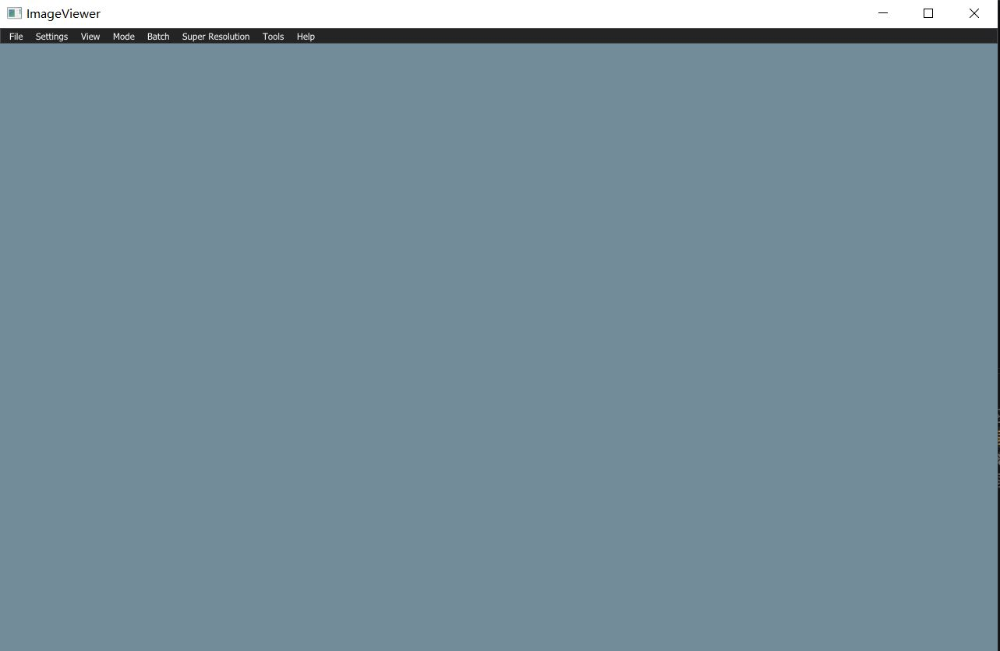

### 多窗口查看

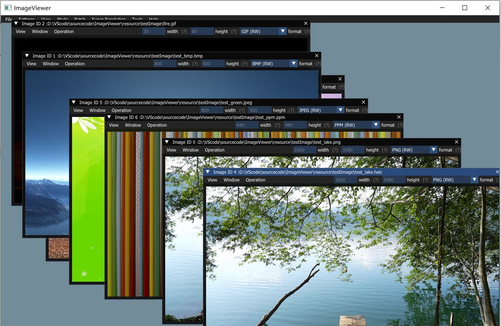

### 图像窗口与控制面板

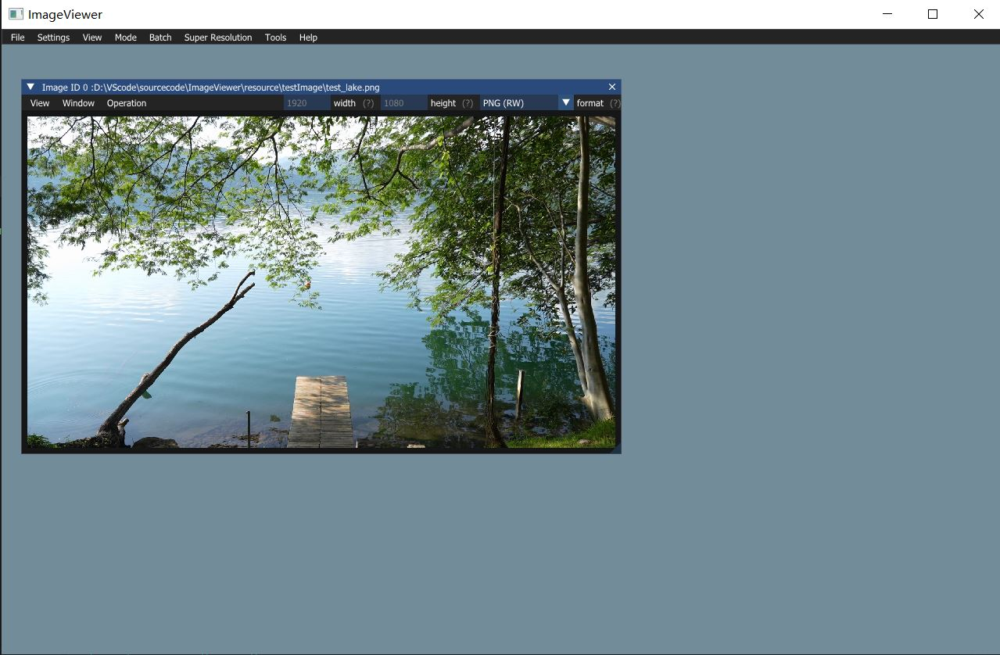

### 双文件对比与 PSNR / MSE

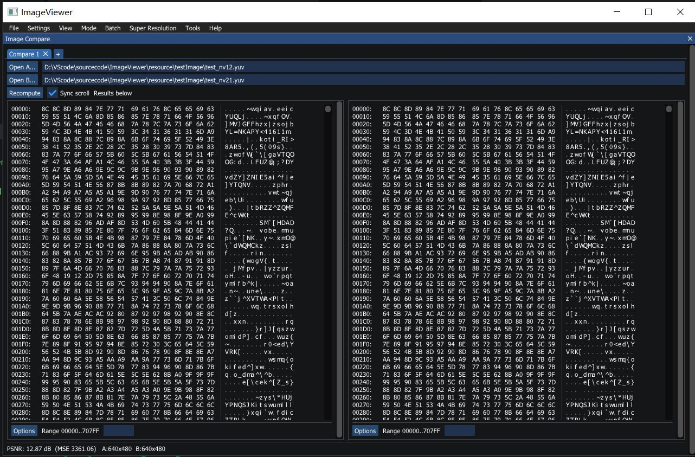

### 原始像素查看

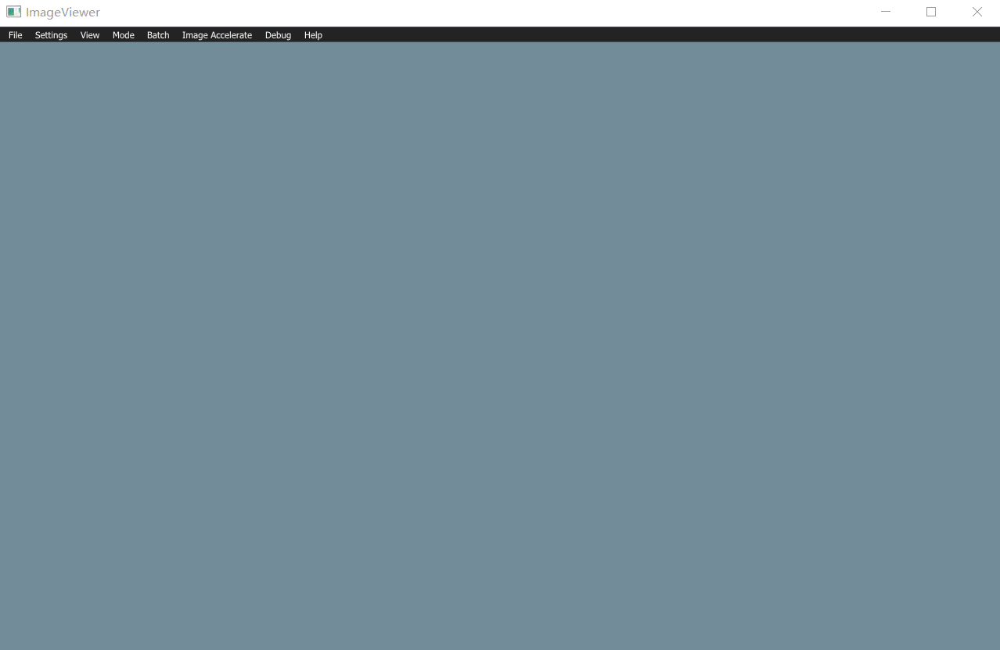

### 单图格式转换

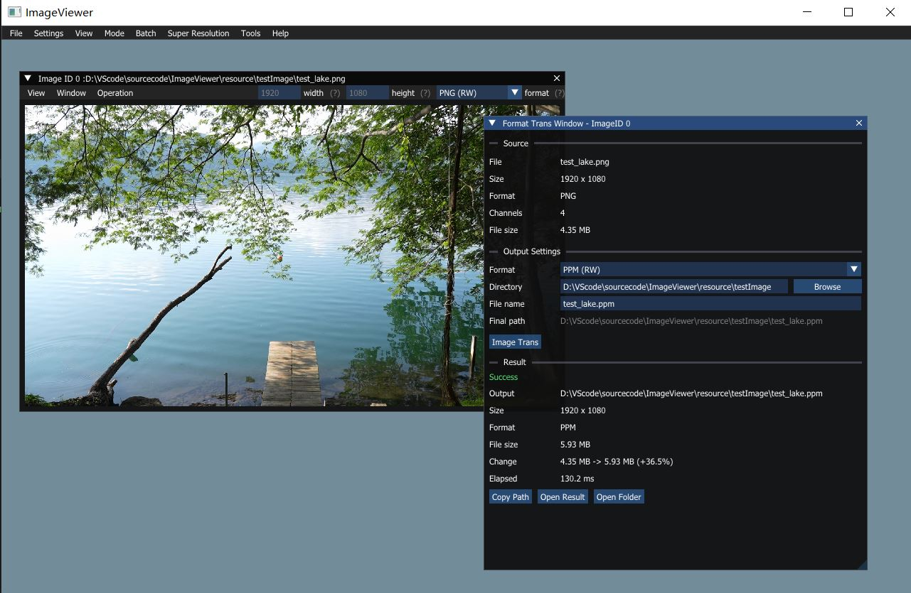

### 批量格式转换

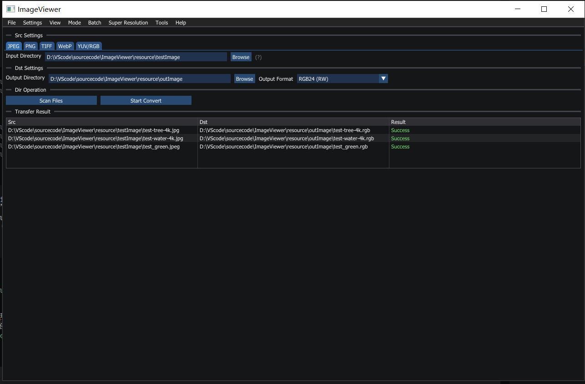

### 批量缩放

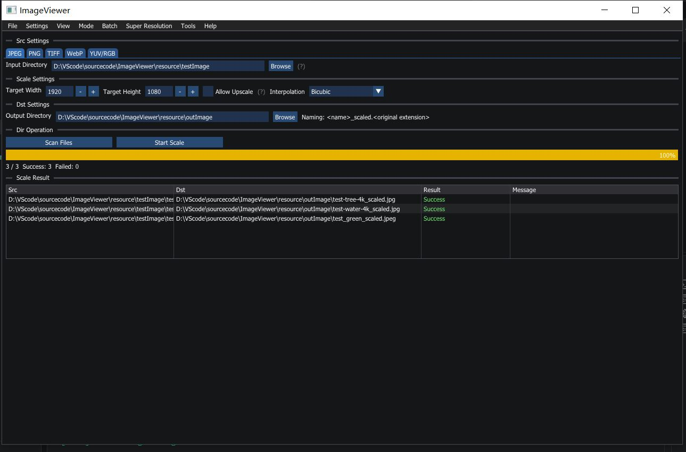

### Upscale to 4K

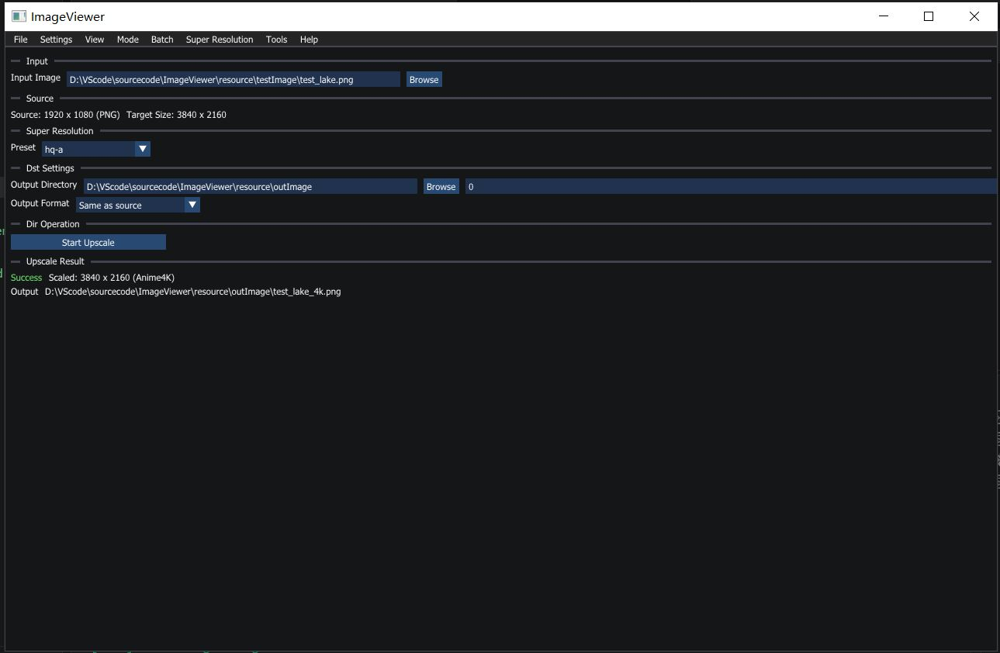

### Restore 修复增强

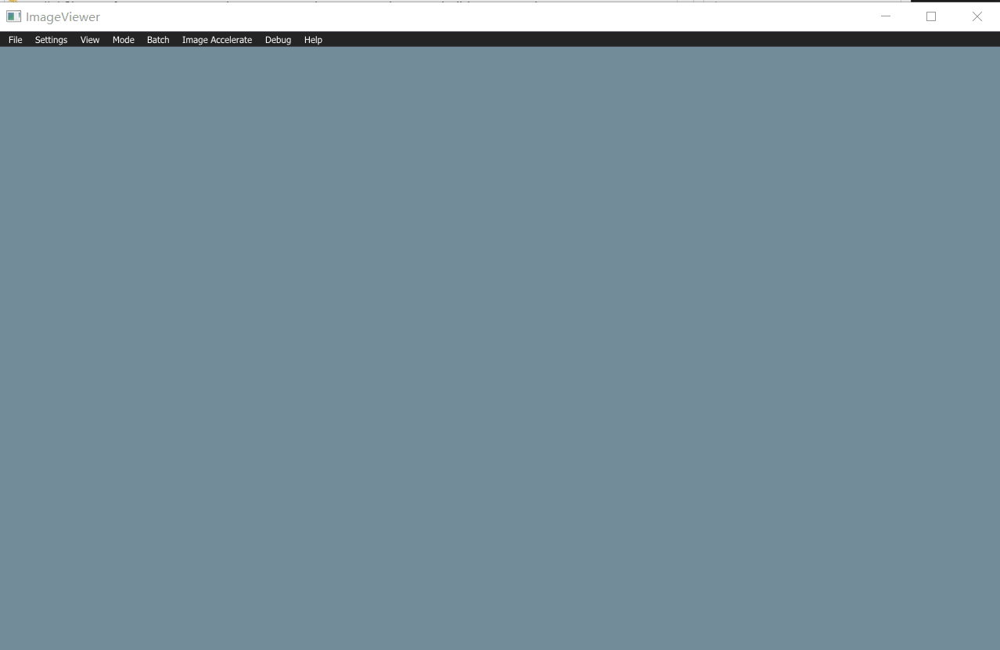

### HDR 图片显示

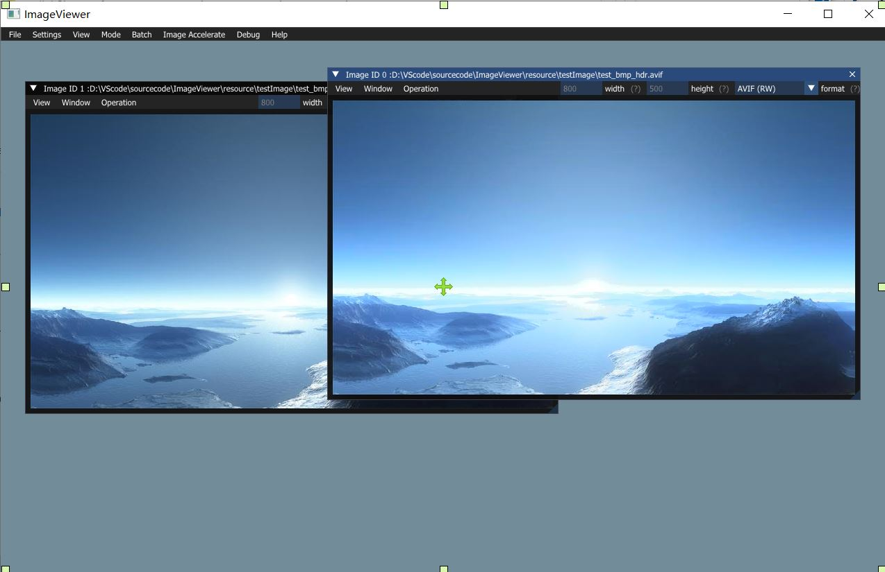

### HDR to SDR

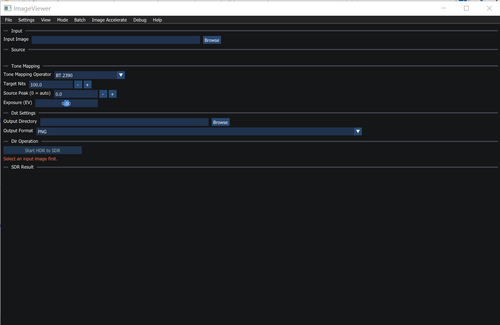

---

## 下载与安装

### 下载

请前往 [Gitee Releases](https://gitee.com/open-release/image-viewer/releases) 下载对应平台的发行包。实际提供的平台与格式以发布页为准。

### 闭源说明

ImageViewer 目前为**闭源项目**，发布页仅提供可执行发行包，不提供源代码下载、源码仓库访问或自行编译支持。本仓库中的文档用于说明软件功能、使用方法、版本授权和隐私策略，不包含项目源代码。

### 发行包内容

ImageViewer 是绿色软件，无需安装。将发行包解压到任意目录即可，路径中建议不要包含特殊字符。发行包中通常包含：

| 文件 | 用途 |
|------|------|
| `ImageViewApp`（Windows 下为 `.exe`） | 图形界面主程序 |
| `formattrans`、`scale`、`rotate`、`imgproc` | 命令行工具 |
| `i18n_zh_CN.lang` | 中文界面语言文件 |

激活专业版后，程序目录中还会生成 `license.lic` 许可证文件。

### 启动

- **Windows**：双击 `ImageViewApp.exe`。
- **Linux**：在程序目录运行 `./ImageViewApp`。

程序默认以 1280 × 800 窗口启动，首次打开时工作区为空。界面语言会根据系统语言自动选择中文或英文，可在 `Settings > Language` 中切换。

### 卸载

程序不会修改系统设置，也不会在系统中留下安装信息。删除整个程序目录即可卸载。

---

## 快速上手

1. **打开图片**：把图片或目录拖入主窗口，或使用 `File > Open` 多选文件。
2. **看清楚**：滚轮缩放、按住左键拖动平移、双击复位；`Shift` + 左键查看像素值；`View > HexPanel` 查看十六进制。
3. **处理好**：在图像窗口 `Operation` 菜单执行格式转换、去噪或缩放；需要批量处理时直接使用 `Batch` 菜单（基础版仅 CPU）；需要超分或 HDR 转换时，激活专业版后使用 `Image Accelerate` 菜单。

### 快捷键与鼠标

| 操作 | 快捷键 / 鼠标 |
|------|----------------|
| 打开文件 | `File > Open`，或直接拖入文件/目录 |
| 退出 | `File > Quit`、窗口关闭按钮或 `Alt+F4` |
| 最大化/还原图像窗口 | `F11` 或 `Ctrl+F`（全局，影响所有图像窗口） |
| 缩放 | 鼠标滚轮 |
| 平移 | 按住鼠标左键拖动 |
| 恢复 100% 缩放和初始位置 | 双击鼠标左键 |
| 像素检查 | `Shift` + 鼠标左键点击图像 |
| 同步对比滚动 | 对比模式勾选 `Sync scroll` |

> `F11` 和 `Ctrl+F` 会同时切换所有已打开图像窗口的最大化状态。`Ctrl+O`、`Ctrl+S` 当前仅作为菜单提示显示，未绑定快捷键。

---

## 基础版与专业版

ImageViewer 使用同一个程序包，通过离线激活码在运行时切换版本。没有有效许可证时以基础版运行。

### 功能对照

| 功能 | 基础版 | 专业版 |
|------|:------:|:------:|
| 图像查看、对比模式 | 支持 | 支持 |
| 单图格式转换 | 支持（CPU） | 支持（CPU + GPU） |
| 单图去噪 | 支持（CPU） | 支持（CPU + GPU） |
| 单图缩放 | 支持（CPU） | 支持（CPU + GPU） |
| 批量格式转换 | 支持（CPU） | 支持（CPU + GPU 可选） |
| 批量缩放 | 支持（CPU） | 支持（CPU） |
| Upscale to 4K（Anime4K） | 不支持 | 支持 |
| Restore（Anime4K） | 不支持 | 支持 |
| SDR to HDR | 不支持 | 支持 |
| HDR to SDR | 不支持 | 支持 |
| 命令行 `--hw` | 回退 CPU 并提示 | 生效 |

基础版并非只能查看：单图格式转换、去噪、缩放以及批量格式转换和批量缩放仍然可用，只是全部使用 CPU。专业版的 GPU 加速会自动选择，无需额外开关；批量缩放始终使用 CPU，批量格式转换在大尺寸图像上可能自动使用 GPU。

### 激活专业版

1. 打开 `Help > License / Activate Pro`。
2. 在窗口底部查看 `Machine ID`；如供应方要求设备绑定，点击 `Copy Machine ID` 复制后提供给对方。
3. 将收到的激活码完整粘贴到窗口中部输入框。
4. 点击 `Activate`，成功后立即生效，无需重启。
5. 窗口会显示 `Edition: Pro`、授权对象和到期时间（如有）。

激活过程完全离线，不需要联网。许可证保存在程序目录的 `license.lic` 中，下次启动自动加载；删除该文件后回到基础版。

---

## 赞助与购买

### 购买专业版

专业版通过离线激活码解锁，无需联网即可激活。基础版免费使用，可根据需要再购买专业版。

| 项目 | 说明 / 链接 |
|------|-------------|
| 购买专业版 | [购买链接待补充](#) <!-- TODO: 替换为实际购买链接 --> |
| 激活方式 | 参见[基础版/专业版与离线授权](doc/edition-guide.md#3-激活专业版) |
| 激活码获取 | 如果使用机器码绑定的方式，购买后将 `Machine ID` 与购买信息提供给供应方,其他方式不用 |

### 赞助支持

ImageViewer 由个人持续维护。如果它对你有帮助，欢迎通过微信或支付宝赞助支持项目发展。赞助完全自愿，不影响基础版的免费使用。

| 微信 | 支付宝 |
|:----:|:------:|
|  | 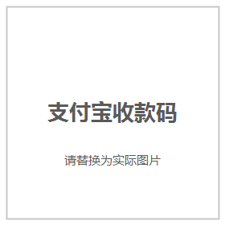 |
---

## 系统要求

| 项目 | 要求 |
|------|------|
| 操作系统 | Windows 10/11（64 位）；Linux（x64 / ARM64） |
| 网络 | 无需网络，程序完全离线运行 |
| GPU（可选） | 显卡与驱动支持 OpenGL 3.3 及以上 |

说明：

- 基础版不需要 GPU。
- 专业版的单图转换、去噪和缩放会在 GPU 可用时自动加速，失败时可回退 CPU。
- Restore、SDR to HDR、HDR to SDR 仅支持 GPU，没有 CPU 回退。
- 具体平台发行包与依赖以 [Releases](https://gitee.com/open-release/image-viewer/releases) 页面为准。

---

## 图像格式支持

实际可读/可写能力取决于发行版本包含的编解码器。界面中的格式下拉框会以 `(RW)`、`(R)`、`(W)` 标记读写能力。

### 常规图片格式

| 格式 | 读取 | 写入 | 说明 |
|------|:----:|:----:|------|
| PNG | 是 | 是 | 默认回退输出格式 |
| JPEG | 是 | 是 | 扩展名 jpg/jpeg/jpe/jfif |
| BMP | 是 | 是 | 扩展名 bmp/dib |
| GIF | 是 | 是 | 支持多帧 |
| TIFF | 是 | 是 | 扩展名 tif/tiff，支持多页 |
| TGA | 是 | 是 | 8-bit RGB/RGBA |
| PSD | 是 | 否 | 仅合成图，不保留图层/蒙版 |
| PPM/PGM/PBM | 是 | 是 | PNM 系列 |
| XBM/XPM | 是 | 是 | - |
| QOI | 是 | 是 | - |
| WebP | 视版本 | 视版本 | 需要发行版本包含 WebP 支持 |
| HEIF/HEIC | 视版本 | 否 | 需要发行版本包含 HEIF 支持；仅读取 |
| AVIF | 视版本 | 视版本 | HDR 输出固定为 AVIF |
| Camera RAW | 视版本 | 否 | 需要发行版本包含 RAW 支持；仅读取 |

### 只读格式

PSD、HEIC、ICO/CUR、ICNS、DDS、KTX、HDR、SVG 等只支持读取，不支持写入。PSD 仅解码合成图，不保留图层和蒙版；SVG 在解码时栅格化为位图。

### 原始像素格式

支持 RGB、YUV、GRAY、BAYER 系列的多种原始格式，例如 RGB24、RGBA、BGRA、NV12、I420、YUY2、Y8 等。这类文件没有文件头：

- 打开时必须手动填写宽、高和格式。
- 作为输出格式生成的文件同样没有文件头，需要记录宽高和格式才能再次打开。
- 批量转换/批量缩放的 `YUV/RGB` 标签页需要手动填写宽、高并选择格式。

完整格式清单见[用户手册附录 C](doc/imageviewer-user-manual.md#附录-c-格式支持)。

---

## 命令行工具

发行包内提供四个命令行工具，适合脚本和自动化处理。它们与图形界面使用同一套图像处理能力。

| 工具 | 用途 | 输入类型 | GPU |
|------|------|----------|-----|
| `formattrans` | 原始像素格式互转，可输出预览图 | 原始像素缓冲区，或 BMP/PPM/JPEG | `--hw` |
| `scale` | 原始像素图像缩放 | 原始像素缓冲区 | `--hw` |
| `rotate` | 原始像素图像旋转 | 原始像素缓冲区 | `--hw` |
| `imgproc` | 普通图片文件的格式转换、旋转、缩放 | PNG/JPEG/BMP/TIFF/WebP 等 | 无 |

```bash
# 原始像素：RGB24 -> NV12
formattrans -i input.rgb -s 1920x1080 --if RGB24 --of NV12 -o output.yuv

# 原始像素缩放
scale -i input.rgb -s 1920x1080 --if RGB24 --os 640x480 -o output.rgb

# 普通图片格式转换
imgproc -i photo.jpg -o photo.webp
```

- `formattrans`、`scale`、`rotate` 必须显式给出输入尺寸和格式；`imgproc` 会自动识别普通图片格式。
- 专业版传入 `--hw` 时使用 GPU；基础版会打印提示并回退 CPU，不会报错退出。
- `imgproc` 没有 `--hw` 参数，始终使用 CPU。

完整参数、INI 配置与更多示例见[命令行工具使用说明](doc/imageviewutils-guide.md)。

---

## 输出文件命名

| 操作 | 输出后缀 | 输出格式 |
|------|----------|----------|
| 单图格式转换 | 无（可手动修改文件名） | 用户选择；默认源格式，否则 PNG |
| 单图去噪 | `_denoise` | `Same as source` 或用户选择 |
| 单图缩放 2x | `_x2` | `Same as source` 或用户选择 |
| 单图缩放 4x | `_x4` | `Same as source` 或用户选择 |
| 单图缩放 1/2x | `_half` | `Same as source` 或用户选择 |
| 单图缩放 1/4x | `_quarter` | `Same as source` 或用户选择 |
| 批量格式转换 | 无 | 用户选择的目标格式 |
| 批量缩放 | `_scaled` | 保留源文件扩展名 |
| Upscale to 4K | `_4k` | `Same as source` 或用户选择 |
| Restore | `_restore` | `Same as source` 或用户选择 |
| SDR to HDR | `_hdr` | 固定 `.avif`（HDR10/PQ10） |
| HDR to SDR | `_sdr` | 默认 PNG，也可选择其他可写常规格式 |

> 批量格式转换不会自动添加后缀，如果在同一目录输出相同格式会覆盖源文件。建议为批量任务单独指定输出目录。

---

## 文档导航

| 文档 | 内容 |
|------|------|
| [ImageViewer 用户手册](doc/imageviewer-user-manual.md) | 安装启动、查看/对比/单图/批量/图像加速、授权、CLI、快捷键、FAQ |
| [ImageViewer 特色功能说明](doc/imageviewer-features.md) | 按使用价值介绍主要功能与典型场景 |
| [基础版/专业版与离线授权](doc/edition-guide.md) | 版本功能对照、激活步骤、常见问题 |
| [命令行工具使用说明](doc/imageviewutils-guide.md) | formattrans/scale/rotate/imgproc 参数、示例与 INI 配置 |
| [隐私策略](doc/privacy-policy.md) | 离线运行、本地数据与个人信息说明 |
| [版本发布](https://gitee.com/open-release/image-viewer/releases) | 下载发行包与查看版本信息 |

---

## 常见问题

### 为什么图像加速菜单是灰的？

图像加速（Upscale to 4K、Restore、SDR to HDR、HDR to SDR）是专业版功能。基础版中这些菜单项可见但不可用，并显示 `Upgrade to Pro...`。批量格式转换和批量缩放无需激活，基础版即可使用，但只使用 CPU。打开 `Help > License / Activate Pro` 激活后即可解锁图像加速和 GPU 加速，无需重启。

### 激活成功但 GPU 功能仍不可用？

请确认：

- 激活窗口显示的是 `Edition: Pro`。
- 显卡驱动正常，且显卡支持 OpenGL 3.3 及以上版本。
- 程序启动时没有出现 GPU 环境创建失败。

Restore、SDR to HDR 和 HDR to SDR 没有 CPU 回退，GPU 环境不可用时无法使用。

### 为什么 Upscale to 4K 显示 “CPU bicubic fallback”？

源图宽度超过 1920 或高度超过 1080 时，无法在 4K 范围内再放大 2 倍，程序会自动改用 CPU 双三次插值，并在结果中标注。这通常不是错误。

### 输出文件在哪里？会覆盖源文件吗？

单图去噪、缩放和图像加速默认输出到源文件所在目录，并添加固定后缀（如 `_denoise`、`_x2`、`_restore`、`_4k`、`_hdr`、`_sdr`），通常不会覆盖源文件。单图格式转换默认保留原文件名，但输出路径与源文件相同时会被拒绝。

### 打开原始像素文件时提示 “Image settings required”？

说明程序无法从文件头判断格式。请在图像窗口顶部填写正确的宽、高，并选择格式。只有 YUV、RGB、GRAY、BAYER 等原始数据需要这一步。

更多问题见[用户手册第 11 章](doc/imageviewer-user-manual.md#11-常见问题)。

---

## 隐私与数据

ImageViewer 是完全离线的本地应用程序：

- 不收集个人信息、图像内容或使用数据。
- 不进行网络通信，不包含广告、分析 SDK 或遥测组件。
- 所有图像读取、显示、转换、缩放、去噪和增强操作都在本机完成。
- Machine ID 仅在本机生成并显示，只有您主动复制并提供给供应方时才会离开设备。
- 激活码在本地校验，许可证文件只保存在本机。

程序只在程序目录或当前工作目录中保存少量本地配置：

| 文件 | 说明 |
|------|------|
| `appConfig.txt` | 界面主题与最近打开的文件列表 |
| `imgui.ini` | 窗口布局、大小和位置 |
| `license.lic` | 专业版许可证 |
| `i18n_zh_CN.lang` | 中文界面语言文件 |
| `imageConfig.txt` | 可选，YUV/RGB 色彩矩阵与 HDR 色调映射设置 |

完整说明见[隐私策略](doc/privacy-policy.md)。

---

## 致谢

ImageViewer 的实现离不开以下开源项目，感谢它们的作者与贡献者：

| 项目 | 用途 | 许可证 |
|------|------|--------|
| [Dear ImGui](https://github.com/ocornut/imgui) | 图形界面框架 | MIT |
| [GLAD](https://github.com/Dav1dde/glad) | OpenGL 函数加载 | MIT |
| [GLFW](https://www.glfw.org/) | 窗口与 OpenGL 上下文管理 | Zlib |
| [stb](https://github.com/nothings/stb) | 图像编解码 | MIT / Public Domain |
| [libwebp](https://github.com/webmproject/libwebp) | WebP 编解码 | BSD-3-Clause |
| [giflib](https://giflib.sourceforge.net/) | GIF 编解码 | MIT |
| [nanosvg](https://github.com/memononen/nanosvg) | SVG 解析 | Zlib |
| [Tiny JPEG Encoder](https://github.com/serge-rgb/TinyJPEG) | JPEG 编码 | Public Domain |
| [Anime4K](https://github.com/bloc97/Anime4K) | 超分与修复着色器 | MIT |
| [imageinfo](https://github.com/xiaozhuai/imageinfo) | 图像格式探测 | MIT |
| [dirent](https://github.com/tronkko/dirent) | 目录遍历 | MIT |
| [Google Test](https://github.com/google/googletest) | 单元测试（开发阶段） | BSD-3-Clause |

---

## 许可证

本发行包基于 [MIT License](LICENSE) 发布，允许商业使用、修改和再分发；分发时请保留版权与许可声明。

第三方组件分别遵循其各自的许可证，均允许商业使用；部分 LGPL / MPL 组件附带相应的分发义务。如需第三方许可证清单，请通过您获取本软件的渠道联系我们。

ImageViewer 目前为闭源项目，不提供源代码；MIT License 不要求公开源代码。

---

## 反馈与联系

- 版本下载与发布页：<https://gitee.com/open-release/image-viewer/releases>
- 问题反馈：请通过您获取本软件的渠道与我们联系。

**ImageViewer 完全离线运行，您的图像和数据始终只属于您自己。**
