# ImageViewer 特色功能说明

ImageViewer 不止是一个“打开看图”的工具。它把图像查看、像素级检查、质量对比和图像处理放在同一个离线程序里，帮助你从“看到图”走到“看清楚、比明白、处理好”。本文按使用价值介绍它的特色功能，完整的操作步骤、字段说明和常见问题见 [ImageViewer 用户手册](imageviewer-user-manual.md)。

---

## 目录

- [功能总览](#功能总览)
- [1. 完全离线，绿色免安装](#1-完全离线绿色免安装)
- [2. 多窗口图像工作台](#2-多窗口图像工作台)
- [3. 专业级原始像素查看](#3-专业级原始像素查看)
- [4. 以鼠标为锚点的精准查看](#4-以鼠标为锚点的精准查看)
- [5. 像素探针：点哪看哪](#5-像素探针点哪看哪)
- [6. 十六进制像素查看](#6-十六进制像素查看)
- [7. 双文件对比与 PSNR/MSE](#7-双文件对比与-psnrmse)
- [8. 单图处理三件套](#8-单图处理三件套)
- [9. 批量处理](#9-批量处理)
- [10. Anime4K 图像加速](#10-anime4k-图像加速)
- [11. HDR 工作流](#11-hdr-工作流)
- [12. 顺手的使用体验](#12-顺手的使用体验)
- [典型使用场景](#典型使用场景)
- [三步快速上手](#三步快速上手)
- [相关文档](#相关文档)

---

## 功能总览

| 特色功能 | 能为你做什么 | 版本 |
|----------|--------------|------|
| 完全离线、绿色免安装 | 解压即用，不上传、不联网，处理敏感图片更放心 | 基础版 / 专业版 |
| 多窗口图像工作台 | 同时打开多张图，最多 32 个窗口，切换对比不丢上下文 | 基础版 / 专业版 |
| 专业级原始像素查看 | 直接查看 YUV、RGB、GRAY、BAYER 等无文件头的原始数据 | 基础版 / 专业版 |
| 以鼠标为锚点的精准查看 | 想放大哪里就放大哪里，像素级定位不跑偏 | 基础版 / 专业版 |
| 像素探针 | `Shift` + 左键点一下，立刻看到坐标和通道值 | 基础版 / 专业版 |
| 十六进制像素查看 | 像看内存一样查看解码后的像素缓冲区 | 基础版 / 专业版 |
| 双文件对比与 PSNR/MSE | 并排看字节差异，同时给出客观质量指标 | 基础版 / 专业版 |
| 单图处理三件套 | 格式转换、去噪、缩放，在当前图像窗口直接完成 | 基础版（CPU）/ 专业版（GPU） |
| 批量处理 | 对整个目录批量转换格式或缩放 | 专业版 |
| Anime4K 图像加速 | 一键超分到 4K、同尺寸修复增强 | 专业版 |
| HDR 工作流 | SDR 转 HDR10 AVIF、HDR 转 SDR，HDR 图片自动适配显示 | 专业版（转换）/ 全版本（查看） |
| 使用体验 | 主题、字号、中英文、通知、FPS 与性能统计 | 基础版 / 专业版 |

---

## 1. 完全离线、绿色免安装

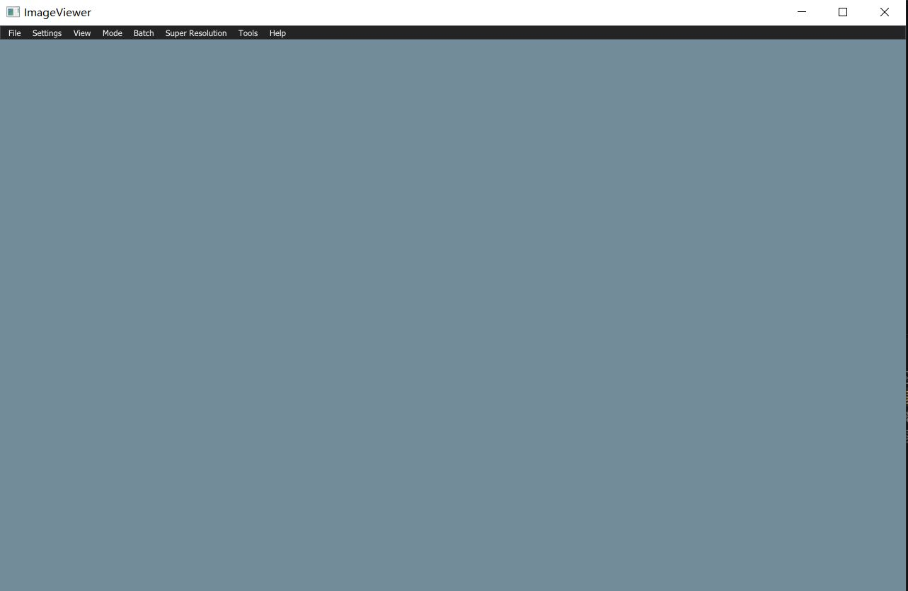

> 主界面：打开图片、切换工作模式都从这里开始。

- **解压即用**：不需要安装程序，也不写系统目录；想换机器时把整个文件夹拷走即可。
- **卸载干净**：删除程序目录就等于卸载，不会在系统里留下安装信息。
- **完全离线**：不联网、不上传图片、不收集个人信息，适合处理内部资料、客户素材或未公开的设计稿。
- **配置留在身边**：主题、最近文件等少量配置只保存在程序目录或当前工作目录。

> 隐私细节见 [隐私策略](privacy-policy.md)。

---

## 2. 多窗口图像工作台

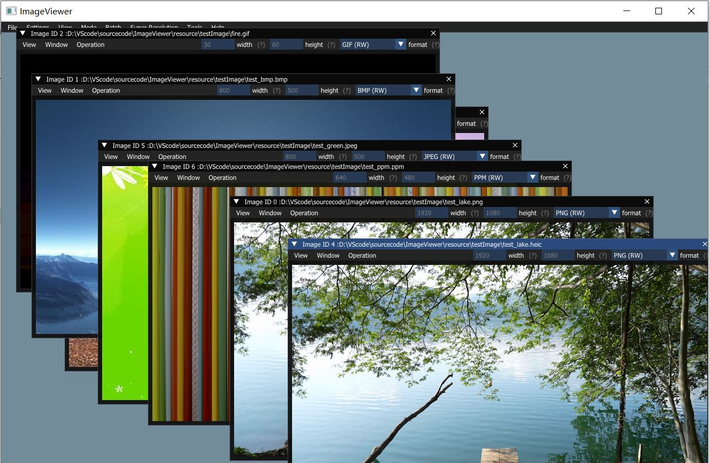

> 多窗口：同时打开多张图片，窗口级联错开排列。

- **最多 32 个图像窗口**同时打开，每张图都有自己的标题、菜单和控制面板。
- **一次打开多张**：`File > Open` 可多选，或把多个文件直接拖进主窗口。
- **拖目录批量打开**：把一个目录拖进来，会打开该目录第一层的所有可识别图片（不递归子目录，避免误开大量文件）。
- **级联排列**：新窗口自动错开，不会完全叠在一起，方便快速切换。
- **最近文件**：保留最近 10 个，随时一键回到上次处理的那张图。
- **异步加载**：图片在后台加载，标题显示 `[Loading...]`，加载期间界面不卡死，可以继续操作其他窗口。
- **全局最大化**：按 `F11` 或 `Ctrl+F` 一次最大化/还原所有图像窗口，适合多屏或大屏快速铺开。

---

## 3. 专业级原始像素查看

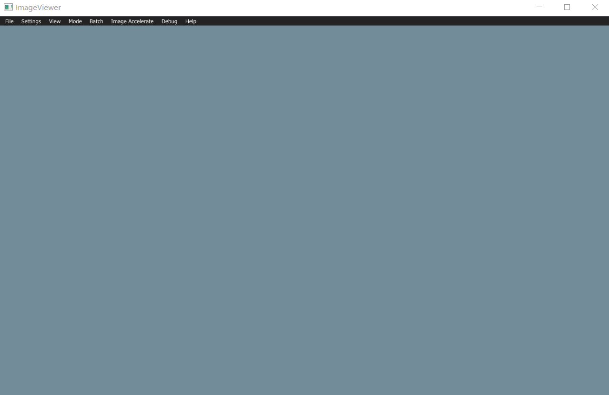

> 原始像素：打开 YUV/RGB 文件后，在图像窗口顶部填写宽、高并选择格式。

普通看图工具遇到没有文件头的原始像素数据往往直接报错，ImageViewer 把这部分做成了正式能力：

- 支持 **RGB、YUV、GRAY、BAYER** 系列的多种原始格式，例如 RGB24、RGBA、BGRA、NV12、I420、YUY2、Y8 等。
- 打开这类文件时，只需在图像窗口顶部填写 **宽、高** 并选择 **格式**，图像会自动重新加载。
- 顶部控件随时可改，方便快速验证不同分辨率、不同排布下的数据是否正确。
- 原始像素也可以转成普通图片格式（如 PNG），便于存档、分享或交给其他工具继续处理。

> 原始像素格式没有文件头，宽高和格式需要你自行记录；作为输出格式生成的文件同样需要这些信息才能再次打开。

---

## 4. 以鼠标为锚点的精准查看

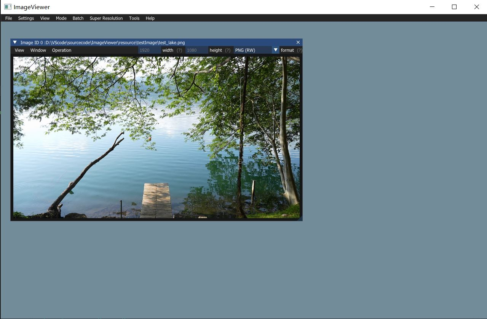

> 图像窗口：图像窗口菜单栏中的 `View > CtrlPanel` 可打开控制面板。

- **鼠标位置缩放**：滚动滚轮时，以鼠标所在位置为中心放大或缩小，想看的细节始终留在视野里，不会跳到图像中心。
- **拖动平移**：按住鼠标左键即可平移画面，平移范围限制在图像边界内，不会把图拖丢。
- **双击复位**：双击左键立即回到 100% 缩放和初始位置，一步回到“原图状态”。
- **CtrlPanel 控制面板**：`View > CtrlPanel` 打开后，可查看缩放比例、显示尺寸、鼠标像素坐标、平移偏移等实时数据，并可：
  - 临时关闭/开启缩放与平移（`Enable Zoom/Pan`）；
  - 锁定宽高比（`Maintain Aspect Ratio`）；
  - 一键 `Reset Zoom/Pan` 复位。
- **缩放范围合理**：最小可缩放到整张图适配窗口，最大可放大到 1 个图像像素约对应 1 个屏幕像素，既能看全貌也能看细节。

---

## 5. 像素探针：点哪看哪

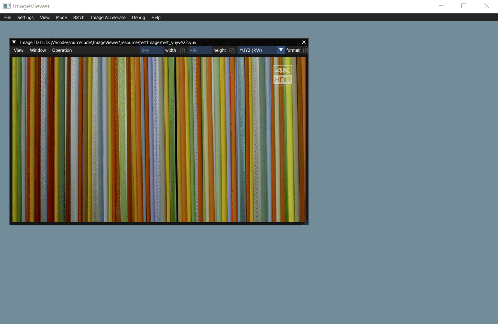

> 像素探针：按住 `Shift` 点击图像，查看该像素的坐标与通道数值。

在图像窗口内按住 **`Shift` + 鼠标左键** 点击任意位置，即可打开像素检查器，查看该像素的：

- 坐标位置；
- 各通道数值（便于确认颜色、位深和通道顺序是否符合预期）。

配合缩放使用，可以快速定位某个异常像素、验证色彩转换结果，或检查原始像素数据的排列是否正确。

---

## 6. 十六进制像素查看

> 十六进制视图：`View > HexPanel` 显示解码后的像素缓冲区内容。

`View > HexPanel` 会把当前图像的**解码后像素缓冲区**以十六进制形式展示出来：

- 像查看内存一样直接读像素原始数值；
- 可用于核对像素排列、通道顺序、位深和数据对齐；
- 与缩放/平移互不影响，放大看图的同时保持十六进制视图；
- 仅在图像成功解码后显示内容，避免把未加载的数据误读成像素。

> 注意：HexPanel 显示的是解码后的像素数据，不是原始压缩文件的字节。想看文件本身的字节差异，请使用[对比模式](#7-双文件对比与-psnrmse)。

---

## 7. 双文件对比与 PSNR/MSE

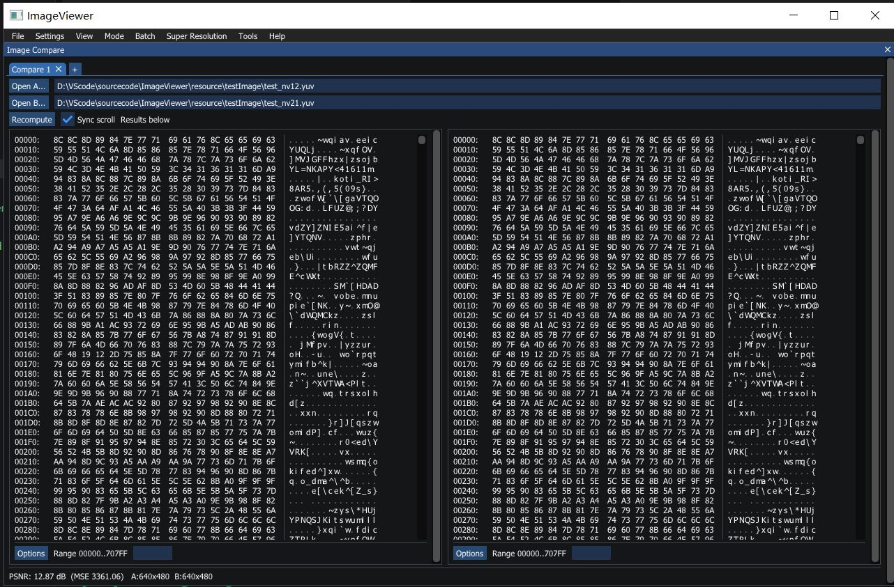

> 对比模式：左侧 A、右侧 B 并排十六进制视图，底部显示 PSNR/MSE。

对比模式把两个文件的原始字节并排显示为十六进制视图，同时计算客观质量指标，适合做“改动前后到底差在哪”的判断：

- **文件逐字节对比**：左侧 A、右侧 B 并排显示，差异一目了然；
- **PSNR / MSE**：两个文件都能解码且尺寸一致时自动给出客观质量数值；
- **尺寸不一致提示**：显示 `PSNR: N/A (dimensions differ: ...)`，避免误判；
- **无法解码也能比**：显示 `PSNR: N/A (...)`，但十六进制对比仍然可用；
- **同步滚动**：勾选 `Sync scroll` 后两侧一起滚动，方便定位差异；
- **多标签对比**：点击标签栏右侧 `+` 新建对比页，可并行处理多组文件；
- **拖拽即用**：拖入两个文件分别填入 A、B，或拖入单个文件放到鼠标所在侧。

它很适合检查两次编码/转换后的文件是否完全一致、比较压缩前后的质量损失、排查文件头和像素数据差异。

---

## 8. 单图处理三件套

每个图像窗口的 `Operation` 菜单都自带三种处理，处理对象就是当前窗口里的这张图，默认输出到源文件所在目录。

### 8.1 格式转换（Format Trans）

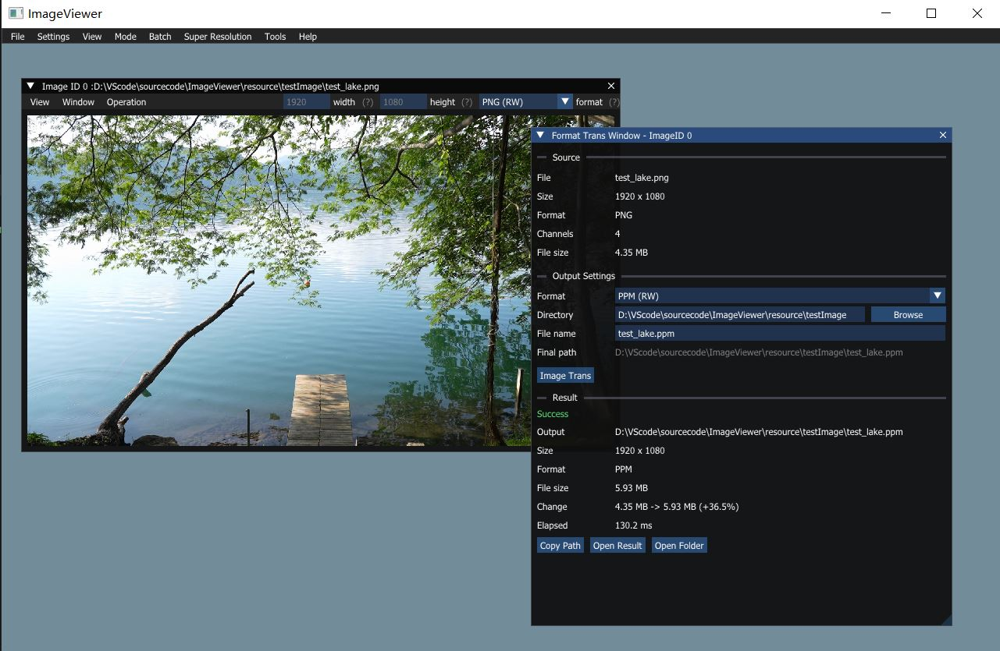

> 格式转换：设置 Format、Directory、File name，`Final path` 预览最终路径。

- 目标格式下拉框会标明读写能力：`(RW)` 可读可写、`(W)` 仅可写、`(R)` 仅可读（不会出现在输出列表）；
- 大多数操作提供 `Same as source`，输出扩展名自动跟随源文件；
- `Final path` 实时预览最终完整路径，避免写错目录或覆盖源文件；
- 输出路径与源文件相同时会被拒绝，保护原图；
- 转换中显示进度和 `Converting...`，可随时 `Cancel`。

### 8.2 去噪（Denoise）

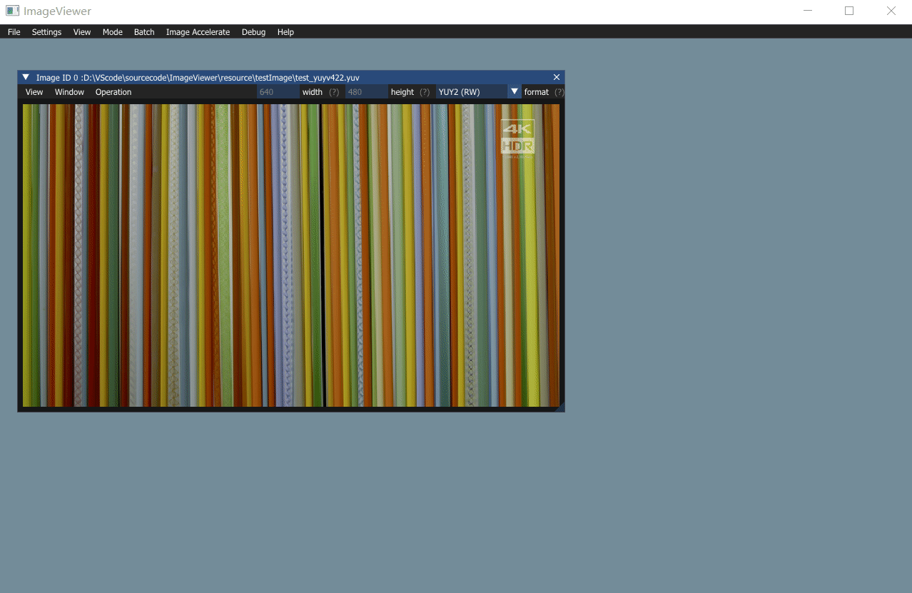

> 去噪：选择算法、输出格式和目录后开始处理。

- 提供 `Average`、`Median`、`Gaussian` 三种算法，默认 `Average`；
- 输出文件名自动加 `_denoise` 后缀，例如 `photo.png` → `photo_denoise.png`；
- 专业版下，大尺寸 RGBA 图像的 `Average`/`Median` 会优先尝试 GPU，失败自动回退 CPU。

### 8.3 缩放（Scale）

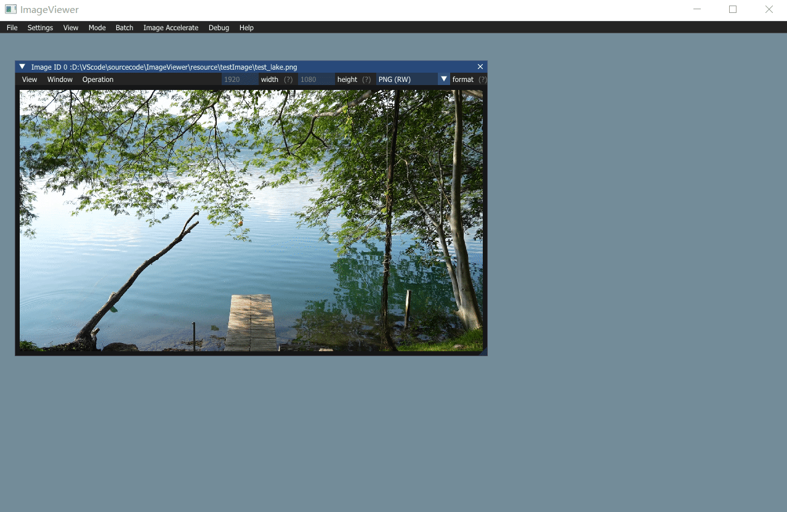

> 缩放：选择倍率并确认目标尺寸后开始处理。

- 支持 `2x`、`4x`、`1/2x`、`1/4x` 四档倍率；
- `Target Size` 实时显示目标尺寸，超过单边 16384 像素会直接提示，无法开始；
- 输出后缀随倍率变化：`_x2`、`_x4`、`_half`、`_quarter`，例如 `photo.png` → `photo_x2.png`；
- 专业版可能自动使用 GPU 加速。

> 通用细节：处理完成后会提供 `Copy Path`、`Open Result`、`Open Folder`，方便复制路径、直接打开结果或定位到输出文件夹。关闭图像窗口不会中断已经开始的去噪或缩放任务。

---

## 9. 批量处理（专业版）

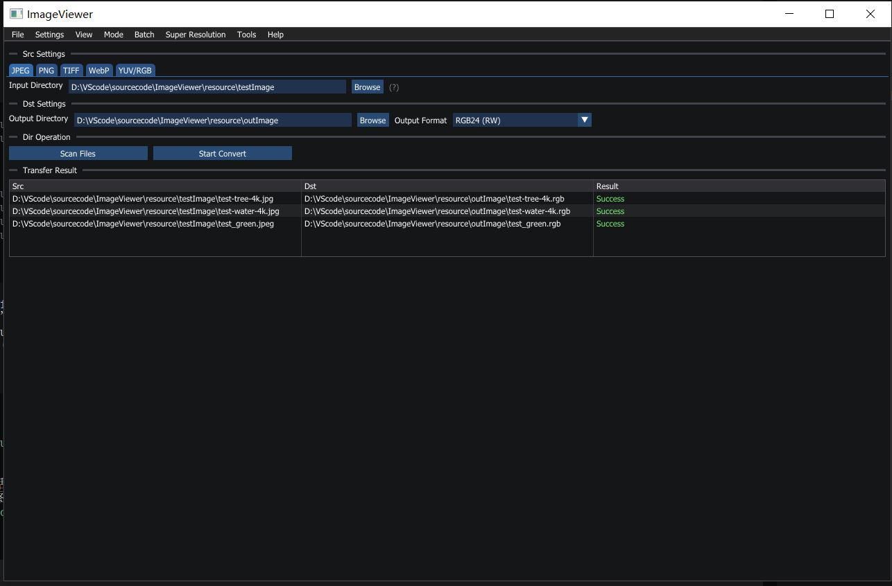

> 批量格式转换：选择输入类型和输出目录，扫描后批量转换，结果表逐文件显示状态。

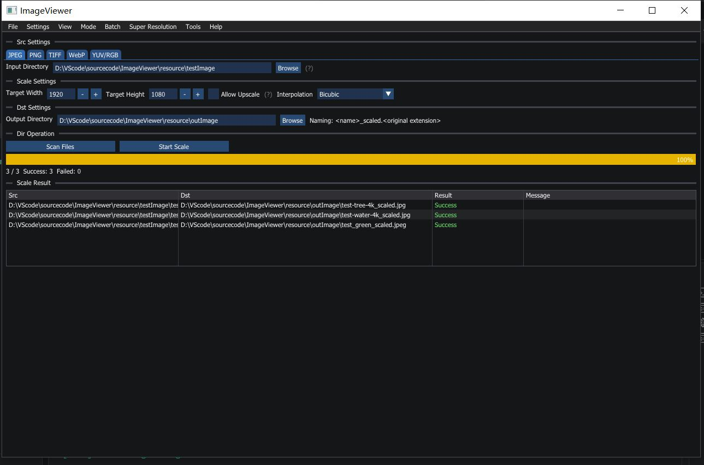

> 批量缩放：选择倍率和插值方式，结果表显示成功/失败计数。

- **批量格式转换**：`Batch > Batch Format Trans`，按 `JPEG` / `PNG` / `TIFF` / `WebP` / `YUV/RGB` 选择输入类型，扫描目录后批量输出到你指定的目录和格式；
- **批量缩放**：`Batch > Batch Scale`，按 `2x` / `4x` / `1/2x` / `1/4x` 缩放，并可选择 `Nearest`、`Bilinear`、`Bicubic` 插值方式；
- **结果表**：逐文件显示 `Src`、`Dst`、`Result` 和失败原因，成功/失败计数一目了然；
- **可取消**：批量任务运行中随时可 `Cancel`，已经写出的文件会保留；
- **安全扫描**：扫描后若修改了输入/输出目录或格式，会提示重新 `Scan Files`，避免按旧列表误处理。

> 批量格式转换不会自动加后缀，如果在同一目录输出相同格式会覆盖源文件。建议为批量任务单独指定输出目录。

---

## 10. Anime4K 图像加速（专业版）

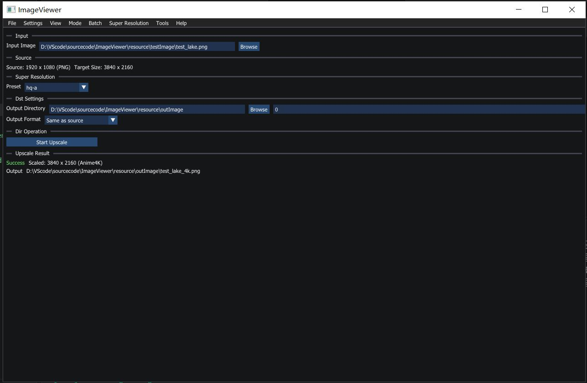

> Upscale to 4K：选择预设和输出目录，将单张图放大到 4K 范围。

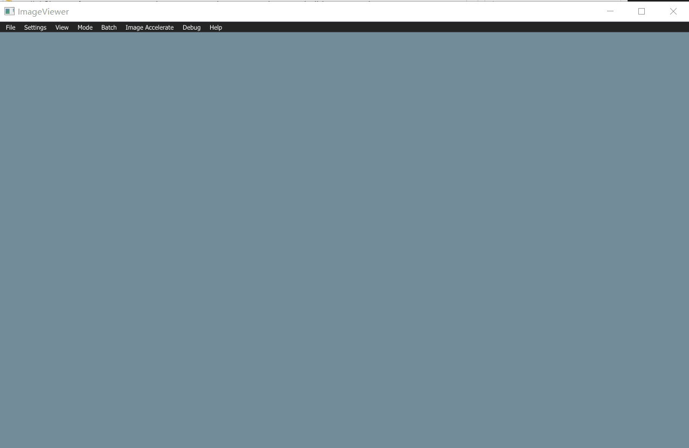

> Restore：选择预设后对图像做同尺寸增强。

- **Upscale to 4K**：`Image Accelerate > Upscale to 4K`，把单张图等比放大到不超过 3840 × 2160；
  - `hq-*` / `fast-*` 各四档预设，默认 `hq-a`，可在速度与画质间选择；
  - 其中 `hq-c` / `fast-c` 与 `hq-d` / `fast-d` 的首级会使用“放大 + 降噪”模型，`hq-d` / `fast-d` 更偏向降噪；
  - 源图宽度超过 1920 或高度超过 1080 时，无法再在 4K 范围内放大 2 倍，程序会自动改用 CPU 双三次插值，并在结果中标注 `CPU bicubic fallback`；
  - 输出后缀 `_4k`。
- **Restore**：`Image Accelerate > Restore`，用 Anime4K Restore 对图像做**同尺寸**增强，不变更大；
  - 提供 `Restore CNN VL (quality)`（默认）、`Restore CNN L`、`Restore CNN M (fast)`、`Restore CNN Soft VL`、`Restore CNN Soft M`、`Restore GAN UL` 等预设；
  - 仅支持 GPU 路径，需要显卡支持 OpenGL 3.3 及以上，没有 CPU 回退；
  - 输出后缀 `_restore`。

> 两个功能都处理**带文件头的普通图片**，原始像素格式（YUV/RGB/GRAY/BAYER）无法作为输入。纹理预算（Texture Budget）用于限制 GPU 中间纹理占用，不确定时保持默认 0 即可。

---

## 11. HDR 工作流（专业版）

普通看图工具通常只认 8-bit SDR 图片，ImageViewer 把 HDR 的“看”和“转”都放进了同一个程序。

### 11.1 直接查看 HDR 图片

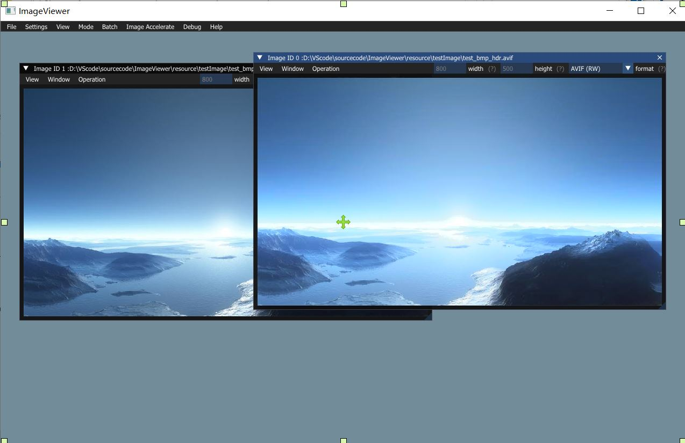

> HDR 显示：打开 Radiance `.hdr` 或 10/12-bit PQ/HLG 的 HEIF/AVIF 后自动适配显示。

- 自动识别 Radiance `.hdr`（线性浮点）以及 10/12-bit PQ/HLG 的 HEIF/HEIC/AVIF；
- 在普通 SDR 显示器上自动做色调映射，不需要额外转换就能直接查看；
- 若觉得画面过暗/过亮，可在程序目录创建 `imageConfig.txt` 调整 `hdrtargetnits`、`hdrexposure`、`hdrsourcepeaknits`，重启生效。

### 11.2 SDR to HDR

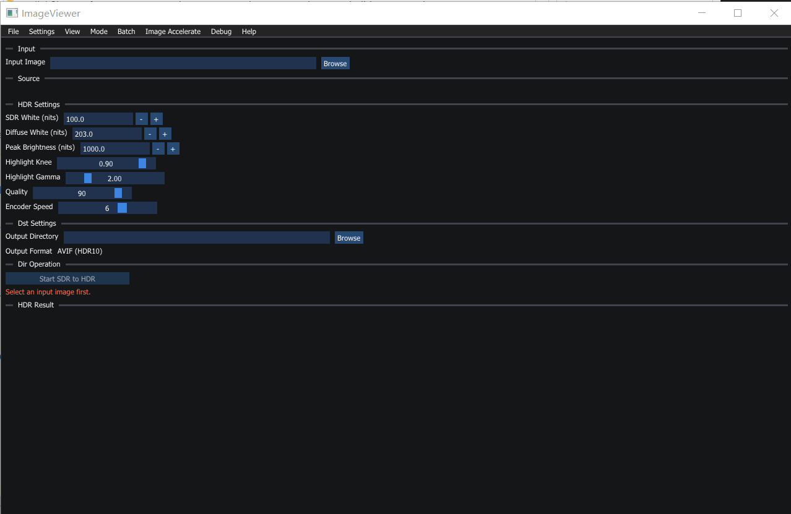

> SDR to HDR：调整亮度、高光和编码参数后输出 HDR10 AVIF。

- 把普通 SDR 图像转换为 **10-bit HDR10（PQ10）AVIF**，包含 BT.2020 色域与 PQ 亮度曲线；
- 可调 SDR 白电平、漫反射白、峰值亮度、高光压缩起点/滚降曲线，以及编码质量与速度；
- 输出文件名加 `_hdr` 后缀，扩展名固定 `.avif`，例如 `photo.png` → `photo_hdr.avif`；
- 输出尺寸不变，不会放大图像。默认参数适合大多数场景，不确定时保持默认即可。

### 11.3 HDR to SDR

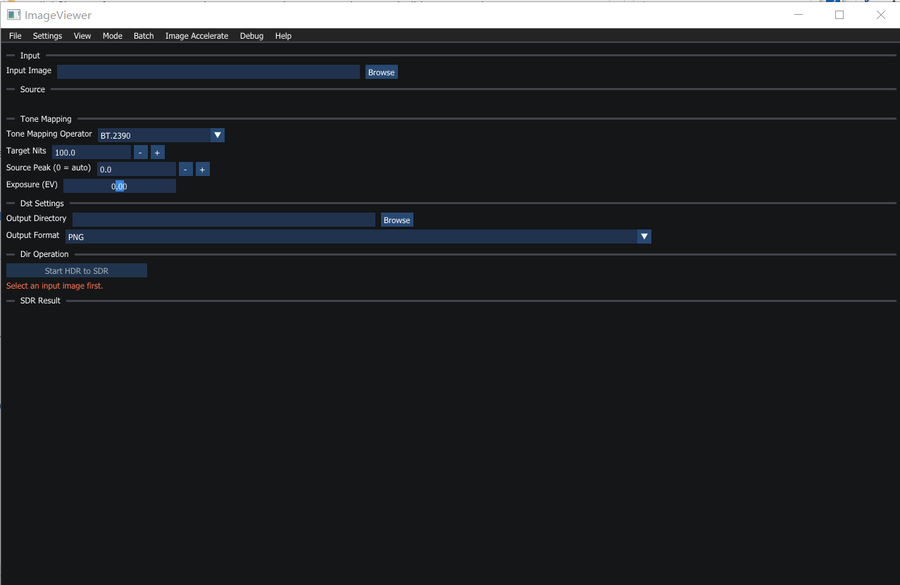

> HDR to SDR：选择色调映射算子和目标亮度后输出 SDR 图片。

- 把 HDR 源图通过 GPU 色调映射转换为普通 **8-bit SDR** 图片；
- 支持 Radiance `.hdr`，以及 10/12-bit PQ/HLG 的 HEIF/HEIC/AVIF；
- 色调映射算子可选 `BT.2390`（默认）、`Reinhard`、`None`，并可设置目标亮度、源峰值和曝光补偿（EV）；
- 输出文件名加 `_sdr` 后缀，默认 PNG，例如 `photo.hdr` → `photo_sdr.png`；
- 需要显卡支持 OpenGL 3.3 及以上，没有 CPU 回退，输出尺寸与源图一致。

---

## 12. 顺手的使用体验

> 主界面：主题和语言可在 `Settings` 菜单中切换。

- **界面主题**：`Settings > Background` 提供深色（Dark）、浅色（Light）、经典（Classic）三种主题，主题选择会保存；
- **界面字号**：`Settings > FontSize` 可在 10–21 之间调整，适合高分屏或演示场景；
- **中英文界面**：根据系统语言自动选择，可在 `Settings > Language` 手动切换；
- **通知提示**：加载失败、转换完成、激活结果等以浮层通知显示，不打断查看；
- **性能可见**：`Debug > Show FPS` 在菜单栏右侧显示 FPS 和帧耗时，`View > Perf Stats Window` 打开性能统计窗口；
- **离线授权**：`Help > License / Activate Pro` 粘贴激活码即可升级专业版，无需联网、无需重启。

> 完整菜单结构见用户手册[附录 A](imageviewer-user-manual.md#附录-a-菜单结构)。

---

## 典型使用场景

### 场景一：摄影/修图，多图反复对照

一次导入一组照片，用多窗口同时查看；滚轮以鼠标为锚点缩放，双击复位；需要确认某个细节像素颜色时，`Shift` + 左键调出像素探针。全程本地离线，原片不会被上传。

### 场景二：编码/压缩后质量验证

把压缩前和压缩后的文件放进对比模式，看字节差异的同时读取 PSNR/MSE，判断质量损失是否可接受；如果差异集中在文件头，也可以借十六进制视图快速定位。

### 场景三：视频/算法前处理，检查原始像素

用 ImageViewer 打开 `YUV`、`RGB`、`BAYER` 等原始数据，填写宽高和格式直接查看，确认色彩矩阵、通道顺序和数据完整性，再交给下游处理。

### 场景四：动漫与截图放大

对分辨率偏低的动漫图或截图使用 `Upscale to 4K`，选择 `hq-*` 预设获得更好的放大效果；想在不改变尺寸的前提下增强清晰度，则使用 `Restore`。

### 场景五：HDR 内容查看与转换

直接打开 `.hdr` 或 HDR HEIF/AVIF 查看（自动适配 SDR 显示）；需要交付普通图片时，用 `HDR to SDR` 做色调映射；需要生成 HDR 素材时，用 `SDR to HDR` 输出 HDR10 AVIF。

---

## 三步快速上手

1. **打开图片**：启动 `ImageViewApp`，把一张图片或一个目录拖进主窗口（也可以 `File > Open`）。
2. **看清楚**：滚轮缩放、按住左键拖动平移、双击复位；按住 `Shift` 点左键看像素值；`View > HexPanel` 看十六进制。
3. **处理好**：在图像窗口 `Operation` 菜单做格式转换/去噪/缩放；需要批量或超分时，激活专业版后使用 `Batch` 与 `Image Accelerate` 菜单。

---

## 相关文档

- [ImageViewer 用户手册（GUI + 命令行）](imageviewer-user-manual.md)
- [基础版/专业版与离线授权说明](edition-guide.md)
- [隐私策略](privacy-policy.md)
- [ImageViewUtils 命令行工具使用说明](imageviewutils-guide.md)
