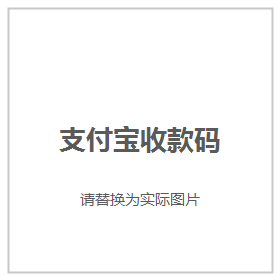

# ImageViewer 用户手册

> - 适用版本：1.0.0
> - 适用程序：ImageViewApp（图形界面）与 ImageViewUtils（命令行工具）
> - 适用平台：Windows 10/11（64 位）；Linux（x64 / ARM64）
> - 最后更新：2026 年 11 月 13 日

ImageViewer 是一款完全离线运行的图像查看与处理工具。本手册介绍如何启动程序、查看与对比图像、进行单张和批量处理，以及如何激活专业版。

---

## 目录

- [1. 快速开始](#1-快速开始)
- [2. 基础版与专业版](#2-基础版与专业版)
- [3. 界面与工作模式](#3-界面与工作模式)
- [4. 查看图像](#4-查看图像)
- [5. 对比模式](#5-对比模式)
- [6. 单图处理](#6-单图处理)
- [7. 批量处理（专业版）](#7-批量处理专业版)
- [8. 图像加速（专业版）](#8-图像加速专业版)
- [9. 命令行工具](#9-命令行工具)
- [10. 设置、快捷键与本地文件](#10-设置快捷键与本地文件)
- [11. 常见问题](#11-常见问题)
- [附录 A. 菜单结构](#附录-a-菜单结构)
- [附录 B. 输出文件命名](#附录-b-输出文件命名)
- [附录 C. 格式支持](#附录-c-格式支持)
- [附录 D. 相关文档](#附录-d-相关文档)

---

## 1. 快速开始

### 1.1 安装与启动

ImageViewer 是绿色软件，无需安装：

1. 将发行包解压到任意目录（路径中建议不要包含特殊字符）。
2. 双击 `ImageViewApp.exe` 启动程序；Linux 下运行同目录中的 `ImageViewApp`。
3. 程序默认以 1280 × 800 窗口启动。首次打开时工作区为空。
4. 界面语言会根据系统语言自动选择中文或英文，可在 `Settings > Language` 中切换。

发行包中通常包含：

| 文件 | 用途 |
|------|------|
| `ImageViewApp`（Windows 下为 `.exe`） | 图形界面主程序 |
| `formattrans`、`scale`、`rotate`、`imgproc` | 命令行工具，见第 9 节 |
| `i18n_zh_CN.lang` | 中文界面语言文件 |

激活专业版后，程序目录中还会生成 `license.lic` 许可证文件。

程序不会修改系统设置，也不会在系统中留下安装信息。卸载时直接删除整个程序目录即可。

需要批量或脚本处理时，可以使用图形界面的批量功能，或第 9 节的命令行工具。

### 1.2 打开图像

支持以下方式：

- 菜单 `File > Open`，在文件对话框中一次选择多个文件。
- 把文件或目录直接拖入主窗口。
- 菜单 `File > Recent Files` 打开最近文件；最多保留 10 个，文件不存在时该项不可点击。
- `File > Recent Files > Clear Recent Files` 清空最近文件列表。

拖入目录时，程序只扫描该目录第一层的图像文件，不会递归扫描子目录。

普通图片（PNG、JPEG、BMP、TIFF 等；WebP 是否可用取决于发行版本）会自动识别格式。原始像素文件（YUV、RGB、GRAY、BAYER 等）没有文件头，打开时会提示 “Image settings required”，需要在图像窗口顶部手动填写宽、高和格式，填写正确后会自动加载。

### 1.3 基本查看

在图像窗口内：

- 滚轮：以鼠标位置为中心缩放。
- 按住鼠标左键拖动：平移图像。
- 双击鼠标左键：恢复 100% 缩放并回到左上角。
- `Shift` + 鼠标左键点击：打开像素检查器，查看该像素的坐标和通道值。
- `F11` 或 `Ctrl+F`：最大化/还原图像窗口。

> `F11` 和 `Ctrl+F` 是全局快捷键，会同时切换所有已打开图像窗口的最大化状态，而不只是当前窗口。

### 1.4 处理一张图

在图像窗口菜单栏选择 `Operation`：

- `Format Trans`：转换格式。
- `Denoise`：去噪。
- `Scale`：按 2×、4×、1/2×、1/4× 缩放。

这些操作都只处理当前图像，默认输出到源文件所在目录；去噪和缩放会自动添加固定后缀，格式转换则默认保留原文件名（可手动修改）。详细说明见第 6 节。

### 1.5 批量处理与图像加速

批量格式转换、批量缩放，以及 Upscale to 4K、Restore、SDR to HDR、HDR to SDR 都属于专业版功能：

- 批量：`Batch > Batch Format Trans` / `Batch > Batch Scale`
- 图像加速：`Image Accelerate > Upscale to 4K` / `Restore` / `SDR to HDR` / `HDR to SDR`

基础版中这些菜单项可见但置灰，并显示 `Upgrade to Pro...` 入口。

---

## 2. 基础版与专业版

ImageViewer 使用同一个程序包，通过离线激活码在运行时切换版本。没有有效许可证时以基础版运行。

### 2.1 功能对照

| 功能 | 基础版 | 专业版 |
|------|:------:|:------:|
| 图像查看、对比模式 | 支持 | 支持 |
| 单图格式转换 | 支持（CPU） | 支持（CPU + GPU） |
| 单图去噪 | 支持（CPU） | 支持（CPU + GPU） |
| 单图缩放 | 支持（CPU） | 支持（CPU + GPU） |
| 批量格式转换 | 不支持 | 支持 |
| 批量缩放 | 不支持 | 支持 |
| Upscale to 4K（Anime4K） | 不支持 | 支持 |
| Restore（Anime4K） | 不支持 | 支持 |
| SDR to HDR | 不支持 | 支持 |
| HDR to SDR | 不支持 | 支持 |
| 命令行 `--hw` | 回退 CPU 并提示 | 生效 |

说明：

- 基础版并非只能查看；单图格式转换、去噪和缩放仍然可用，只是全部使用 CPU。
- 专业版的 GPU 加速是自动选择的，不需要额外开关。显卡或驱动不可用时，部分功能可能仍然回退 CPU 或无法启动。
- 基础版即使传入命令行 `--hw` 也不会报错退出，而是打印提示后使用 CPU。

### 2.2 激活专业版

购买专业版请访问 [购买链接待补充](#)。<!-- TODO: 替换为实际购买链接 -->

1. 打开 `Help > License / Activate Pro`。
2. 在窗口底部查看 `Machine ID`。如果供应方要求设备绑定，点击 `Copy Machine ID` 复制后提供给对方。
3. 把收到的激活码粘贴到窗口中部的多行输入框。
4. 点击 `Activate`。
5. 成功后立即生效，窗口会显示 `Edition: Pro`、授权对象和到期时间（如有）。
6. 许可证会保存在程序目录的 `license.lic` 中，下次启动自动加载。

激活失败时，窗口会提示失败原因；常见原因包括激活码无效、已过期、与当前 Machine ID 不匹配。许可证无效不会阻止程序启动，程序会回退到基础版。

### 2.3 查看当前版本

`Help > About ImageViewer` 窗口会显示：

- `ImageViewer Edition: Basic` 或 `ImageViewer Edition: Pro`
- 专业版的 `Licensed to` 和 `License expires`
- 基础版的许可证错误信息（如有）

### 2.4 赞助支持

如果 ImageViewer 对你有帮助，欢迎通过微信或支付宝赞助支持项目维护。赞助完全自愿，不影响基础版的免费使用。

| 微信 | 支付宝 |
|:----:|:------:|
|  |  |

> 二维码为占位图片，请替换为实际收款码。<!-- TODO: 替换为实际的微信/支付宝收款二维码 -->

---

## 3. 界面与工作模式

### 3.1 主界面组成

1. **主菜单栏**：File、Settings、View、Mode、Batch、Image Accelerate、Debug、Help。
2. **工作区**：查看模式下显示多个图像窗口；对比、批量、图像加速模式下显示对应的全区域面板。
3. **通知提示**：加载失败、转换完成、激活结果等信息以浮层提示显示。
4. **状态信息**：开启 `Debug > Show FPS` 后，菜单栏右侧显示 FPS 和帧耗时。

### 3.2 工作模式

| 模式 | 入口 | 用途 | 版本 |
|------|------|------|------|
| 查看模式（Viewer Mode） | `Mode > Viewer Mode` | 打开并查看一张或多张图像 | 基础版/专业版 |
| 对比模式（Compare Mode） | `Mode > Compare Mode` | 并排比较两个文件的字节内容和 PSNR | 基础版/专业版 |
| 批量格式转换（Batch Format Trans） | `Batch > Batch Format Trans` | 转换目录中的图像格式 | 专业版 |
| 批量缩放（Batch Scale） | `Batch > Batch Scale` | 按倍率批量缩放目录中的图像 | 专业版 |
| Upscale to 4K | `Image Accelerate > Upscale to 4K` | 将单张图像放大到 4K 范围 | 专业版 |
| Restore | `Image Accelerate > Restore` | 同尺寸增强单张图像 | 专业版 |
| SDR to HDR | `Image Accelerate > SDR to HDR` | 将 SDR 图像转换为 HDR10 AVIF | 专业版 |
| HDR to SDR | `Image Accelerate > HDR to SDR` | 将 HDR 源图转换为 8-bit SDR 图片 | 专业版 |

模式切换的行为：

- 查看模式下打开的图像窗口不会被关闭；切到其他模式时只是隐藏，切回查看模式后仍在。
- 对比、批量、图像加速面板会占用主菜单栏以下的整个工作区，主菜单栏始终可用。
- 批量格式转换、批量缩放、Upscale、Restore、SDR to HDR、HDR to SDR 面板没有关闭按钮，需要切换到 `Mode > Viewer Mode` 或 `Mode > Compare Mode` 离开。
- 对比模式窗口右上角的关闭按钮等同于退出对比模式并返回查看模式。

### 3.3 图像窗口管理

- 同时最多打开 32 个图像窗口。
- 每个图像窗口的标题栏显示 `Image ID n : 文件路径`。
- 图像加载中时，标题会显示 `[Loading...]`。
- 关闭图像窗口会释放对应的窗口位置，之后可以继续打开新图像。
- 达到窗口上限时程序会给出提示，关闭不需要的窗口后即可继续打开。

---

## 4. 查看图像

### 4.1 图像窗口菜单

每个图像窗口都有自己的菜单栏：

| 菜单 | 菜单项 | 说明 |
|------|--------|------|
| View | CtrlPanel | 显示/隐藏控制面板（缩放比例、显示尺寸、鼠标像素坐标、平移偏移） |
| View | HexPanel | 显示/隐藏十六进制查看器 |
| Window | MaxView（F11） | 最大化/还原当前窗口 |
| Operation | Format Trans | 打开单图格式转换窗口 |
| Operation | Denoise | 打开单图去噪窗口 |
| Operation | Scale | 打开单图缩放窗口 |

图像窗口顶部右侧还有宽、高、格式三个控件，用于原始像素文件的手动设置或重新加载。

### 4.2 缩放与平移

- 滚轮缩放范围取决于图像尺寸：最小可缩放到整张图适配窗口，最大可放大到 1 个图像像素对应约 1 个屏幕像素。
- 缩放以鼠标位置为锚点，不会跳到图像中心。
- 按住鼠标左键拖动平移；平移范围限制在图像边界内。
- 双击图像恢复 100% 缩放和初始位置。
- 在 CtrlPanel 中可以：
  - 勾选/取消 `Enable Zoom/Pan` 临时禁用缩放和平移。
  - 勾选/取消 `Maintain Aspect Ratio`。
  - 点击 `Reset Zoom/Pan` 恢复缩放和位置。
  - 查看 `Texture Size`、`Display Size`、`Zoom Level`、`Pan Offset`、`Mouse Pos`。
- CtrlPanel 是独立窗口，点击标题栏关闭按钮会隐藏；`View > CtrlPanel` 的勾选状态会同步取消，再次勾选即可重新显示。

### 4.3 十六进制查看

`View > HexPanel` 打开内存编辑器，显示当前图像**解码后的像素缓冲区**，不是原始压缩文件字节；只有在图像成功解码后才会显示内容。十六进制视图与缩放/平移互不影响，可用于检查像素排列、通道顺序和原始数值。点击标题栏关闭按钮会隐藏窗口，`View > HexPanel` 的勾选状态同步取消。

### 4.4 原始像素文件

打开无法自动识别格式的文件时，会提示 “Image settings required”：

1. 点击 `OK` 关闭提示。
2. 在图像窗口顶部填写 `width`、`height`。
3. 在 `format` 下拉框选择正确的原始格式。
4. 设置有效后图像自动重新加载。

如果宽高与文件大小不匹配，图像可能无法加载或显示异常。请确认文件确实是未压缩的原始像素缓冲区，而不是带文件头的普通图片。

### 4.5 多窗口操作

- `File > Open` 一次选择多个文件时，会依次打开为多个图像窗口。
- 拖入多个文件时，每个文件打开一个窗口。
- 拖入一个目录时，目录第一层的所有可识别图像会批量打开。
- 窗口会按级联方式错开排列，避免完全重叠。
- `F11` / `Ctrl+F` 会影响所有图像窗口，而不是只影响当前窗口。

---

## 5. 对比模式

### 5.1 用途

对比模式不是图像预览，而是把两个文件的字节内容并排显示为十六进制视图，并计算 PSNR/MSE。它适合：

- 检查两次编码/转换后的文件是否完全一致。
- 比较压缩前后的质量差异。
- 排查文件头、对齐、像素数据差异。

### 5.2 基本操作

1. 打开 `Mode > Compare Mode`。
2. 点击 `Open A...` 选择左侧文件，点击 `Open B...` 选择右侧文件。
3. 两个文件都加载后，底部显示 PSNR 和 MSE。
4. 点击 `Recompute` 重新计算。
5. 勾选 `Sync scroll` 后，两侧十六进制视图会同步滚动。
6. 点击标签栏右侧的 `+` 新建一个对比标签页；点击标签上的关闭按钮关闭该标签页。
7. 关闭对比窗口或选择其他模式即可离开。

也可以直接拖入文件：

- 拖入两个或更多文件：前两个分别填入 A、B。
- 拖入一个文件：放到鼠标所在的左侧或右侧面板。

### 5.3 PSNR 显示规则

- 两侧文件都能解码且尺寸一致时，显示 `PSNR: xx.xx dB (MSE ...)`。
- 尺寸不一致时显示 `PSNR: N/A (dimensions differ: ...)`。
- 无法解码时显示 `PSNR: N/A (image could not be decoded; hex comparison is still available)`。
- 像素位深不受支持时显示 `PSNR: N/A (unsupported pixel depth)`。
- 计算过程中显示 `PSNR: computing...`。

即使 PSNR 不可用，十六进制对比仍然可用。

---

## 6. 单图处理

单图处理在查看模式下进行。打开图像后，在图像窗口选择 `Operation > Format Trans`、`Operation > Denoise` 或 `Operation > Scale`。

### 6.1 共同规则

- 输出目录留空或保持默认时，输出到源文件所在目录。
- 输出格式下拉框只列出当前版本支持的写入格式。格式名称后的标记含义：
  - `(RW)`：可读取，也可写入。
  - `(W)`：只能写入。
  - `(R)`：只能读取（不会出现在输出格式列表中）。
- 大多数处理都提供 `Same as source`（与源格式相同）选项；选择后输出扩展名跟随源文件。
- 去噪和缩放会使用“源文件名 + 固定后缀”；格式转换默认保留原文件名，可在 `File name` 中修改。固定后缀见附录 B。
- 处理完成后通常会显示结果信息，并提供 `Copy Path`、`Open Result`、`Open Folder`：
  - `Copy Path`：复制输出文件路径。
  - `Open Result`：在查看器中打开结果（仅普通格式且文件存在时可用）。
  - `Open Folder`：在系统文件管理器中定位输出文件。
- 同一个输出目录中重复处理同名文件会覆盖已有文件。建议为不同处理设置不同输出目录，或先确认文件名。

### 6.2 单图格式转换（Format Trans）

入口：图像窗口 `Operation > Format Trans`。

界面字段：

| 字段 | 说明 |
|------|------|
| Format | 目标格式，列出所有可写格式 |
| Directory | 输出目录，默认源文件目录 |
| File name | 输出文件名，默认源文件名；切换格式时会自动改成对应扩展名 |
| Final path | 最终完整路径预览 |

操作步骤：

1. 选择目标 `Format`。
2. 确认 `Directory` 和 `File name`。
3. 点击 `Image Trans`。
4. 转换过程中显示进度和 `Converting...`，可点击 `Cancel` 取消。
5. 完成后可打开结果或复制路径。

默认行为：

- 首次打开时，如果源格式本身可写，默认目标格式为源格式；否则回退到 PNG。
- 原始像素格式不会被自动选为目标格式，避免生成无法直接重新打开的文件。
- 如果修改了设置但没有重新转换，界面会提示 `Settings changed since last conversion`，这不是错误，只是提醒当前结果对应旧设置。

常见错误：

- `Output directory does not exist`：输出目录不存在，请重新选择。
- `Output path matches the source image`：输出路径和源文件相同，会覆盖源文件，请改名或换目录。
- `File name is empty`：文件名为空。
- `Source image is not available`：图像尚未加载完成或数据不可用。

### 6.3 单图去噪（Denoise）

入口：图像窗口 `Operation > Denoise`。

界面字段：

| 字段 | 说明 |
|------|------|
| Algorithm | 去噪算法：`Average`、`Median`、`Gaussian`，默认 `Average` |
| Output Format | 输出格式，默认 `Same as source` |
| Directory | 输出目录，默认源文件目录 |
| Output | 最终输出路径预览 |

操作步骤：

1. 选择 `Algorithm`。
2. 选择 `Output Format`（通常保持 `Same as source`）。
3. 确认 `Directory`。
4. 点击 `Start Denoise`。
5. 运行中可点击 `Cancel`；完成后可复制路径、打开结果或打开所在目录。

说明：

- 去噪没有强度参数，只能选择算法。
- 输出文件名后缀为 `_denoise`，例如 `photo.png` → `photo_denoise.png`。
- 基础版强制使用 CPU。专业版下，`Average`/`Median` 对大于 1080p 的 RGBA 图像会优先尝试 GPU，失败时自动回退 CPU；`Gaussian` 始终使用 CPU。

### 6.4 单图缩放（Scale）

入口：图像窗口 `Operation > Scale`。

界面字段：

| 字段 | 说明 |
|------|------|
| Factor | `2x`、`4x`、`1/2x`、`1/4x`，默认 `2x` |
| Target Size | 按当前倍率计算出的目标尺寸 |
| Output Format | 输出格式，默认 `Same as source` |
| Directory | 输出目录，默认源文件目录 |
| Output | 最终输出路径预览 |

操作步骤：

1. 选择 `Factor`。
2. 确认 `Target Size` 没有显示 `Output size exceeds the limit`。
3. 选择 `Output Format` 和 `Directory`。
4. 点击 `Start Scale`。
5. 运行中可点击 `Cancel`；完成后可打开结果。

说明：

- 输出后缀随倍率变化：`_x2`、`_x4`、`_half`、`_quarter`。例如 `photo.png` 选择 2x 后输出 `photo_x2.png`，选择 1/2x 后输出 `photo_half.png`。
- 单边输出尺寸上限为 16384 像素；超过时无法开始缩放。
- 单图缩放不提供插值算法选择；批量缩放才提供 `Nearest`、`Bilinear`、`Bicubic`。
- 基础版使用 CPU；专业版可能自动使用 GPU。

### 6.5 单图处理注意事项

- 单图格式转换、去噪、缩放都作用于当前图像窗口，不处理目录中的其他文件。
- 如果图像仍在加载（标题显示 `[Loading...]`），操作按钮会禁用，等待加载完成即可。
- 原始像素输入可以转换为普通图片格式，便于后续直接重新打开；反向转换为原始格式时，需要记录宽高和格式。
- 如果输出格式下拉框中没有某个格式，说明当前版本未包含该格式支持。
- 关闭图像窗口不会中断已经开始的去噪或缩放任务；任务完成时仍会显示结果通知。

---

## 7. 批量处理（专业版）

批量处理必须先激活专业版。基础版中 `Batch` 菜单项置灰，并显示 `Upgrade to Pro...`。

### 7.1 批量格式转换（Batch Format Trans）

入口：`Batch > Batch Format Trans`。

界面分区：

1. **Src Settings**：选择输入格式标签页。
   - `JPEG`、`PNG`、`TIFF`、`WebP`：只扫描对应扩展名的文件。
   - `YUV/RGB`：扫描原始像素格式，需要填写 `width`、`height` 并选择 `format`。
2. **Dst Settings**：设置 `Output Directory` 和 `Output Format`。
3. **Dir Operation**：`Scan Files`、`Start Convert`、`Cancel`。
4. **Transfer Result**：结果表，列为 `Src`、`Dst`、`Result`。

操作步骤：

1. 在 `Src Settings` 选择正确的输入格式标签页。
2. 填写或选择 `Input Directory`。
3. 设置 `Output Directory` 和 `Output Format`。
4. 点击 `Scan Files`，结果表会列出扫描到的文件。
5. 点击 `Start Convert`。
6. 运行中可点击 `Cancel`；结果表中的状态会从 `Pending` 变为 `Success` 或 `Failed`。

重要规则：

- 输入目录只扫描第一层，不递归子目录。
- 扫描会按当前输入格式的扩展名过滤文件。
- 如果在 `Scan Files` 之后修改了输入格式、输入目录、输出目录或输出格式，请再次点击 `Scan Files`，否则结果表可能仍是旧列表，输出路径或扩展名也可能与当前设置不一致。
- 输出文件名保持源文件主名，扩展名改为目标格式；不添加额外后缀。
- 如果输出目录等于输入目录且目标格式与源格式相同，输出会覆盖源文件。建议使用独立输出目录。
- 如果输出格式列表包含原始像素格式，生成的文件没有文件头，需要记录宽高和格式才能重新打开。

### 7.2 批量缩放（Batch Scale）

入口：`Batch > Batch Scale`。

界面分区：

1. **Src Settings**：`JPEG`、`PNG`、`TIFF`、`WebP`、`YUV/RGB` 标签页。
2. **Scale Settings**：
   - `Factor`：`2x`、`4x`、`1/2x`、`1/4x`。
   - `Interpolation`：`Nearest`、`Bilinear`、`Bicubic`。
3. **Dst Settings**：`Output Directory`，界面会显示命名规则 `Naming: <name>_scaled.<original extension>`。
4. **Dir Operation**：`Scan Files`、`Start Scale`、`Cancel`。
5. **Scale Result**：结果表，列为 `Src`、`Dst`、`Result`、`Message`，并显示进度和成功/失败计数。

操作步骤：

1. 选择输入格式标签页并填写 `Input Directory`。
2. 选择 `Factor` 和 `Interpolation`。
3. 设置 `Output Directory`。
4. 点击 `Scan Files`。
5. 点击 `Start Scale`。
6. 运行中可点击 `Cancel`；完成后查看结果表和失败原因。

重要规则：

- 批量缩放会保留源文件扩展名，只添加 `_scaled` 后缀。例如 `photo.jpg` → `photo_scaled.jpg`。
- 批量缩放会校验扫描参数：如果扫描后修改了输入目录、输入格式、输出目录，或原始格式的宽高，界面会提示 `Settings changed. Scan Files again before starting.`，此时 `Start Scale` 不可用，必须重新扫描。只修改倍率或插值不需要重新扫描，下一次开始时会使用新值。
- 未扫描时会提示 `Scan Files first.`。
- 输入目录或输出目录不存在时，扫描会显示对应错误。
- 单边输出尺寸上限同样为 16384 像素。

### 7.3 批量处理注意事项

- 批量面板没有关闭按钮；离开时使用 `Mode > Viewer Mode` 或 `Mode > Compare Mode`。
- 批量任务运行期间可以取消，但已经写出的文件不会自动删除。
- 批量缩放的结果表会在 `Message` 列显示失败原因；批量格式转换只显示 `Failed`，可检查输入/输出目录是否正确、文件是否被其他程序占用。
- 批量格式转换的按钮是 `Start Convert`，批量缩放的按钮是 `Start Scale`，两者不要混淆。

---

## 8. 图像加速（专业版）

图像加速处理单张图像，入口在 `Image Accelerate` 菜单。基础版中菜单项置灰。

四个功能都处理**带文件头的图片**。Upscale to 4K、Restore 和 SDR to HDR 支持常规图片格式（如 PNG、JPEG、BMP、TIFF，以及当前版本支持的 WebP、HEIF、AVIF）；HDR to SDR 只接受 Radiance `.hdr`，以及 10/12-bit PQ/HLG 的 HEIF/HEIC/AVIF。原始像素格式（YUV、RGB、GRAY、BAYER）没有文件头，无法自动探测宽高，不能作为图像加速的输入。

### 8.1 Upscale to 4K

入口：`Image Accelerate > Upscale to 4K`。

用途：把单张图像等比放大，使其不超过 3840 × 2160（4K）范围。例如 16:9 图像会放大到 3840 × 2160，4:3 图像会放大到 2880 × 2160。

界面字段：

| 字段 | 说明 |
|------|------|
| Input Image | 输入图像路径，可点击 `Browse` 选择 |
| Source | 显示源尺寸、格式和目标尺寸 |
| Preset | `hq-a`、`hq-b`、`hq-c`、`hq-d`、`fast-a`、`fast-b`、`fast-c`、`fast-d`，默认 `hq-a` |
| Output Directory | 输出目录，留空则写到源文件所在目录 |
| 输出目录右侧整数框 | GPU 纹理预算（MB），0 表示不限制 |
| Output Format | `Same as source` 或可写格式 |
| Output | 输出路径预览 |

操作步骤：

1. 选择输入图像。
2. 选择 `Preset`。`hq-*` 和 `fast-*` 各四档，默认 `hq-a`；不同档位在速度与效果上不同，建议先用小图试跑。`hq-c` / `fast-c` 与 `hq-d` / `fast-d` 的首级使用放大加降噪模型，其中 `hq-d` / `fast-d` 更偏向“放大 + 降噪”。
3. 设置 `Output Directory` 和 `Output Format`。
4. 点击 `Start Upscale`。
5. 运行中可点击 `Cancel`；完成后结果显示 `Scaled: 宽 x 高 (Anime4K)` 或 `Scaled: 宽 x 高 (CPU bicubic fallback)`。

说明：

- 输出后缀为 `_4k`，例如 `photo.png` → `photo_4k.png`。
- 输出格式默认跟随源格式；也可以选择其他可写格式。
- 小图会使用 Anime4K 放大。如果源图宽度超过 1920 或高度超过 1080，就无法在 4K 范围内再放大 2 倍，程序会自动改用 CPU 双三次插值，结果会明确标注 `CPU bicubic fallback`。
- 需要 Anime4K 的源图在 GPU 不可用时无法开始；可以改用更小的源图，或检查显卡驱动是否正常。
- 纹理预算用于限制 GPU 中间纹理占用；不确定时保持默认 0。

### 8.2 Restore

入口：`Image Accelerate > Restore`。

用途：使用 Anime4K Restore 对图像做同尺寸增强，输出尺寸与源图相同，不做放大。

界面字段：

| 字段 | 说明 |
|------|------|
| Input Image | 输入图像路径 |
| Source | 显示源尺寸、格式和输出尺寸（与源相同） |
| Preset | 恢复预设 |
| Texture Budget (MB) | GPU 纹理预算，0 表示不限制 |
| Output Directory | 输出目录，留空则写到源文件所在目录 |
| Output Format | `Same as source` 或可写格式 |
| Output | 输出路径预览 |

可选的 `Preset`：

- `Restore CNN VL (quality)`（默认）
- `Restore CNN L`
- `Restore CNN M (fast)`
- `Restore CNN Soft VL`
- `Restore CNN Soft M`
- `Restore GAN UL`

操作步骤：

1. 选择输入图像。
2. 选择 `Preset`。
3. 设置输出目录和输出格式。
4. 点击 `Start Restore`。
5. 运行中可点击 `Cancel`；完成后结果显示 `Restored: 宽 x 高`。

说明：

- 输出后缀为 `_restore`，例如 `photo.png` → `photo_restore.png`。
- Restore 只支持 GPU 路径，没有 CPU 回退，需要显卡支持 OpenGL 3.3 及以上版本。如果界面提示 `Anime4K is not available`，`Start Restore` 会保持禁用。
- 输出尺寸与源图一致，不要把它当作放大工具；需要放大请使用 Upscale to 4K。

### 8.3 SDR to HDR

入口：`Image Accelerate > SDR to HDR`。

用途：把普通 SDR 图像转换为 HDR10（PQ10）AVIF 文件，输出尺寸与源图相同。

界面字段：

| 字段 | 说明 | 默认值 |
|------|------|--------|
| Input Image | 输入图像路径 | - |
| Source | 源尺寸、格式和输出尺寸 | - |
| SDR White (nits) | SDR 白电平亮度 | 100 |
| Diffuse White (nits) | 漫反射白目标亮度 | 203 |
| Peak Brightness (nits) | HDR 峰值亮度，范围 1–10000 | 1000 |
| Highlight Knee | 高光压缩起点，范围 0–1 | 0.90 |
| Highlight Gamma | 高光滚降曲线，范围 0.1–10 | 2.00 |
| Quality | 编码质量，范围 0–100 | 90 |
| Encoder Speed | 编码速度，范围 0–9 | 6 |
| Output Directory | 输出目录，留空则写到源文件所在目录 | - |
| Output Format | 固定为 `AVIF (HDR10)` | - |
| Output | 输出路径预览 | - |

操作步骤：

1. 选择输入图像。
2. 按需要调整亮度、高光和编码参数。大多数情况下保持默认即可。
3. 设置 `Output Directory`。
4. 点击 `Start SDR to HDR`。
5. 运行中可点击 `Cancel`；完成后显示 `Success`、输出尺寸、峰值亮度和输出路径。

说明：

- 输出后缀为 `_hdr`，扩展名固定为 `.avif`，例如 `photo.png` → `photo_hdr.avif`。
- 输出为 10-bit HDR10（PQ10）AVIF，包含 BT.2020 色域、PQ 亮度曲线和母版显示信息。
- 需要播放器或查看器支持 HDR AVIF 才能正确显示亮度效果。
- 需要显卡支持 OpenGL 3.3 及以上版本，并且当前版本包含 HDR 编码支持。如果界面提示 `HDR conversion is not available` 或 `HDR AVIF output is not available`，说明当前环境不支持，`Start SDR to HDR` 会保持禁用。
- SDR White、Diffuse White、Peak Brightness 的单位都是 nits（cd/m²）。不确定时不要随意把 Peak Brightness 调得很高，否则高光可能过曝或与目标显示器不匹配。
- Highlight Knee 越小，高光压缩开始得越早；Highlight Gamma 控制滚降曲线形状。
- 输出尺寸不变，不会放大图像。

### 8.4 HDR to SDR

入口：`Image Accelerate > HDR to SDR`。

用途：把 HDR 源图通过 GPU 色调映射转换为普通 8-bit SDR 图片，输出尺寸与源图相同。

支持的输入：

- Radiance `.hdr`（线性浮点）。
- 10/12-bit PQ 或 HLG 的 HEIF/HEIC/AVIF。

普通 8-bit HEIF/AVIF 或 SDR 图像不能作为输入，程序会提示 `HDR source is not PQ or HLG`。

界面字段：

| 字段 | 说明 | 默认值 |
|------|------|--------|
| Input Image | 输入图像路径，可点击 `Browse` 选择 | - |
| Source | 源尺寸、格式和输出尺寸 | - |
| Tone Mapping Operator | `BT.2390`、`Reinhard`、`None` | `BT.2390` |
| Target Nits | SDR 目标亮度，范围 1–10000 | 100 |
| Source Peak (0 = auto) | 源峰值亮度；0 表示自动读取元数据或测量内容峰值 | 0 |
| Exposure (EV) | 曝光补偿，范围 -5–5 stops | 0 |
| Output Directory | 输出目录，留空则写到源文件所在目录 | - |
| Output Format | 默认为 `PNG`，也可选择其他可写常规格式 | `PNG` |
| Output | 输出路径预览 | - |

操作步骤：

1. 选择输入图像。
2. 按需要调整色调映射、目标亮度和曝光。大多数情况下保持默认即可。
3. 设置 `Output Directory` 和 `Output Format`。
4. 点击 `Start HDR to SDR`。
5. 运行中可点击 `Cancel`；完成后显示 `Success`、输出尺寸、源峰值和输出路径。

说明：

- 输出后缀为 `_sdr`，默认输出 PNG，例如 `photo.hdr` → `photo_sdr.png`。
- 输出为 8-bit RGBA SDR 图片；Radiance `.hdr` 的 1.0 按漫反射白（100 nits）处理，HEIF/AVIF 按 PQ/HLG 传递函数处理。
- 需要显卡支持 OpenGL 3.3 及以上版本。如果界面提示 `HDR to SDR conversion is not available`，说明当前环境不支持，`Start HDR to SDR` 会保持禁用。
- HDR to SDR 没有 CPU 回退，也不改变输出尺寸。

---

## 9. 命令行工具

ImageViewUtils 提供四个命令行工具，适合脚本和自动化处理。它们与图形界面使用同一套图像处理能力，但参数风格不同。

### 9.1 可执行文件位置

命令行工具与图形界面位于同一目录：

```text
ImageViewer/
├── ImageViewApp.exe
├── formattrans.exe
├── scale.exe
├── rotate.exe
└── imgproc.exe
```

Linux 下没有 `.exe` 后缀。

在 Windows 上使用命令行工具：

1. 打开 `ImageViewer` 目录。
2. 在地址栏输入 `powershell` 并回车，或在目录空白处按住 `Shift` 右键选择“在此处打开 PowerShell 窗口”。
3. 输入 `.\formattrans.exe --help` 查看帮助。

在 Linux 上打开终端，切换到程序目录后运行 `./formattrans --help`。

### 9.2 工具总览

| 工具 | 用途 | 输入类型 | GPU |
|------|------|----------|-----|
| `formattrans` | 原始像素格式互转，可输出预览图 | 原始像素缓冲区，或 BMP/PPM/JPEG | `--hw` |
| `scale` | 原始像素图像缩放 | 原始像素缓冲区 | `--hw` |
| `rotate` | 原始像素图像旋转 | 原始像素缓冲区 | `--hw` |
| `imgproc` | 普通图片文件的格式转换、旋转、缩放 | PNG/JPEG/BMP/TIFF/WebP 等 | 无 |

`formattrans`、`scale`、`rotate` 必须显式给出输入尺寸和格式；`imgproc` 会自动识别普通图片格式，并从输出扩展名推断目标格式。

### 9.3 常用示例

```bash
# 原始像素：RGB24 -> NV12
formattrans -i input.rgb -s 1920x1080 --if RGB24 --of NV12 -o output.yuv

# 原始像素：NV12 -> BGRA，并生成 BMP 预览图
formattrans -i input.yuv -s 640x480 --if NV12 --of BGRA -o output.rgb --pic preview.bmp

# 原始像素缩放
scale -i input.rgb -s 1920x1080 --if RGB24 --os 640x480 -o output.rgb

# 原始像素旋转 90 度
rotate -i input.rgb -s 1920x1080 --if RGB24 --angle 90 -o output.rgb

# 普通图片格式转换
imgproc -i photo.jpg -o photo.webp

# 普通图片旋转并转换
imgproc -i photo.png -o photo.jpg --rotate 90

# 按宽度生成缩略图
imgproc -i photo.jpg -o thumb.jpg --width 320
```

### 9.4 常用参数

`formattrans`、`scale`、`rotate` 的通用参数：

| 参数 | 说明 |
|------|------|
| `-i, --in <file>` | 输入文件 |
| `-o, --out <file>` | 输出文件 |
| `-s, --size WxH` | 输入图像尺寸，必填 |
| `--if <FORMAT>` | 输入格式，如 `NV12`、`RGB24`、`RGBA` |
| `--hw` | 启用 GPU 加速（专业版） |
| `--cfg <file>` | 从 INI 文件读取参数 |
| `--perf` | 结束后打印性能统计 |
| `--perf-trace <file>` | 记录性能跟踪文件，可用 Chrome 浏览器打开查看 |
| `-h, --help` | 显示帮助 |

`scale` 额外使用 `--os WxH` 指定输出尺寸。`rotate` 使用 `-a, --angle <度>`，正值为顺时针，90°/270° 时输出宽高自动交换。

`imgproc` 参数：

| 参数 | 说明 |
|------|------|
| `-i, --in <file>` | 输入图片文件，自动识别格式 |
| `-o, --out <file>` | 输出文件，扩展名决定格式 |
| `-f, --format <name>` | 目标格式：`jpeg`、`png`、`bmp`、`tiff`、`ppm`、`gif`，以及当前版本支持的 `webp`、`heif` |
| `-r, --rotate <度>` | 旋转角度 |
| `-w, --width <px>` | 目标宽度；只给宽度时保持宽高比 |
| `-h, --height <px>` | 目标高度；只给高度时保持宽高比 |
| `-s, --scale <百分比>` | 缩放百分比，范围 1–200 |
| `-v, --verbose` | 输出详细过程 |
| `-?, --help` | 显示帮助 |

> 注意：`imgproc` 中 `-h` 表示高度，不是帮助。查看帮助请使用 `-?` 或 `--help`。

### 9.5 GPU 与性能统计

- 专业版传入 `--hw` 时使用 GPU；基础版会打印提示并回退 CPU，不会报错退出。
- `imgproc` 没有 `--hw` 参数，始终使用 CPU。
- 使用 `--perf` 可以打印本次运行的性能统计，使用 `--perf-trace <file>` 可以记录性能跟踪文件。
- 如果在处理 YUV 或 RGB 原始像素时颜色异常，可以通过 `imageConfig.txt` 调整色彩矩阵（见 10.4 节）。

---

## 10. 设置、快捷键与本地文件

### 10.1 Settings 菜单

| 菜单项 | 作用 | 是否保存 |
|--------|------|----------|
| `Background > Dark/Light/Classic` | 切换界面主题 | 是，下次启动恢复 |
| `FontSize` | 选择界面字号，10–21 | 否，重启恢复默认 |
| `Language > English/中文` | 切换界面语言 | 否，重启后按系统语言重新选择 |

### 10.2 View / Debug 菜单

- `View > Perf Stats Window`：打开 `Perf Stats` 窗口，查看程序运行时的性能统计信息。普通使用无需关注。
- `Debug > Show FPS`：在菜单栏右侧显示 FPS 和帧耗时，用于了解刷新性能。
- `Help > About ImageViewer`：查看程序版本、当前版本（基础版/专业版）和授权信息。

### 10.3 快捷键与鼠标

| 操作 | 快捷键/鼠标 |
|------|-------------|
| 打开文件 | `File > Open`，或直接拖入文件/目录 |
| 退出 | `File > Quit`，或窗口关闭按钮 / `Alt+F4` |
| 最大化/还原图像窗口 | `F11` 或 `Ctrl+F`（全局，影响所有图像窗口） |
| 缩放 | 鼠标滚轮 |
| 平移 | 按住鼠标左键拖动 |
| 恢复 100% 和初始位置 | 双击鼠标左键 |
| 像素检查 | `Shift` + 鼠标左键点击图像 |
| 同步对比滚动 | 对比模式勾选 `Sync scroll` |

> `File` 菜单中的 `Ctrl+O`、`Ctrl+S` 只是菜单提示文字，当前版本没有绑定这两个快捷键。请使用菜单操作或拖拽打开文件。

### 10.4 本地文件

ImageViewer 只在程序目录或当前工作目录中保存少量配置，不会写入系统目录：

| 文件 | 说明 |
|------|------|
| `appConfig.txt` | 保存界面主题和最近打开的文件列表；退出时写入 |
| `imgui.ini` | 保存窗口布局、大小和位置，由界面框架自动维护 |
| `license.lic` | 专业版许可证；激活后生成，删除后回到基础版 |
| `i18n_zh_CN.lang` | 中文界面语言文件；缺失时中文界面可能显示英文键名或方块 |
| `imageConfig.txt` | 可选。用于设置 YUV/RGB 色彩矩阵和 HDR 色调映射；普通用户无需创建 |
| 处理结果 | 由用户选择的输出目录决定 |

如果需要恢复默认界面布局，可以关闭程序后删除 `imgui.ini`。删除 `appConfig.txt` 会同时清除主题设置和最近文件列表。

如果处理 YUV/RGB 原始像素时颜色异常，可以在程序目录（通常是启动程序时的工作目录）创建 `imageConfig.txt`，写入 `yuvColorMatrix=bt709`（可选 `bt601`、`bt709`、`bt2020`），然后重启程序。普通图片处理不需要此文件。

HDR 图片（Radiance `.hdr` 和 10/12 位 PQ/HLG 的 HEIF/AVIF）会自动转为 SDR 显示，默认目标亮度 100 nit。若觉得画面过暗或过亮，可添加 `hdrtargetnits=120`、`hdrexposure=0.5`（单位 EV）或 `hdrsourcepeaknits=1000` 调整；`hdrtonemap=off` 可关闭转换（不推荐，画面可能出现严重过曝）。修改后需重启程序。

---

## 11. 常见问题

### 11.1 为什么批量菜单是灰的？

批量格式转换、批量缩放和图像加速都是专业版功能。基础版中这些菜单项可见但不可用，旁边会显示 `Upgrade to Pro...`。打开 `Help > License / Activate Pro` 激活后即可使用，无需重启。

### 11.2 激活成功但 GPU 功能仍不可用？

可能原因：

- 显卡或驱动不支持程序需要的 OpenGL 3.3 环境。
- 程序启动时创建 GPU 环境失败。
- 当前使用的是基础版激活码，或激活码已过期、设备不匹配。

可以先重启程序；仍不可用则更新显卡驱动。部分功能会回退 CPU，但 Restore、SDR to HDR 和 HDR to SDR 没有 CPU 回退。

### 11.3 为什么 Upscale to 4K 显示 “CPU bicubic fallback”？

这通常不是错误。源图如果宽度超过 1920 或高度超过 1080，就无法在 4K 范围内再放大 2 倍，Anime4K 不适用，程序会自动使用 CPU 双三次插值把图像适配到 4K 范围。结果信息会明确标注。

### 11.4 为什么 Restore 的 Start 按钮是灰的？

Restore 只支持 GPU。如果界面显示 `Anime4K is not available`，说明当前显卡环境不可用，按钮会保持禁用。先确认专业版已激活、显卡驱动正常，再重启程序。

### 11.5 激活失败怎么办？

检查：

- 激活码是否完整粘贴，没有多余空格或换行。
- 激活码是否已过期。
- 供应方是否绑定了 Machine ID；如果绑定了，必须在对应机器上激活。
- 窗口底部显示的 Machine ID 是否与提供给供应方的一致。

失败原因会显示在通知中。许可证无效不会阻止程序以基础版启动。

### 11.6 批量转换点击 Start Convert 没有反应？

检查：

- 是否已经点击 `Scan Files`，结果表是否有文件。
- 输入目录和输出目录是否存在。
- 输入格式标签页是否与目录中的文件扩展名匹配。
- 是否在扫描后修改了设置；如果修改了，请重新 `Scan Files`。

### 11.7 批量缩放提示 “Settings changed. Scan Files again before starting.”？

这是正常的保护机制。修改输入目录、输入格式、输出目录，或原始格式的宽高后，必须重新扫描，`Start Scale` 才会启用。只修改倍率或插值不需要重新扫描。

### 11.8 输出文件在哪里？会覆盖源文件吗？

单图去噪、缩放和图像加速默认输出到源文件所在目录，并添加固定后缀（如 `_denoise`、`_x2`、`_restore`、`_4k`、`_hdr`、`_sdr`），通常不会覆盖源文件。单图格式转换默认保留原文件名，但输出路径与源文件相同时会被拒绝。批量格式转换不添加后缀，如果在同一目录输出相同格式，会覆盖源文件；建议为批量任务使用独立输出目录。

### 11.9 为什么 Ctrl+O 没有反应？

当前版本只在菜单中显示了 `Ctrl+O` 提示，并未绑定该快捷键。请使用 `File > Open` 或直接拖入文件。真正可用的全局快捷键是 `F11` 和 `Ctrl+F`。

### 11.10 图像窗口最大化后看不到窗口菜单？

最大化会隐藏图像窗口的标题栏和菜单栏。按 `F11` 或 `Ctrl+F` 还原即可重新看到菜单。

### 11.11 打开原始像素文件时提示 “Image settings required”？

说明程序无法从文件头判断格式。请在图像窗口顶部填写正确的宽、高，并选择格式。普通图片不需要这一步；只有 YUV、RGB、GRAY、BAYER 等原始数据需要。

### 11.12 中文界面显示为英文或方块？

确认 `i18n_zh_CN.lang` 位于程序目录或当前工作目录。如果系统缺少中文字体，界面文字可能显示为方块；安装中文字体后重启程序。

### 11.13 主题、字号和语言会保存吗？

- 主题会保存，下次启动恢复。
- 字号和语言只在当前运行期间生效，重启后恢复默认（语言按系统语言重新选择）。
- 最近文件列表会保存，最多 10 个。

### 11.14 SDR to HDR 的输出为什么是 AVIF？

HDR 模式固定输出 10-bit HDR10（PQ10）AVIF，文件扩展名为 `.avif`。输出尺寸与源图相同，文件名添加 `_hdr` 后缀。需要支持 HDR AVIF 的查看器或播放器才能正确显示亮度效果。

---

## 附录 A. 菜单结构

### A.1 主菜单

| 菜单 | 菜单项 |
|------|--------|
| File | Open、Save、Save As..、Recent Files、Clear Recent Files、Quit |
| Settings | Background（Dark/Light/Classic）、FontSize（10–21）、Language（English/中文） |
| View | Perf Stats Window |
| Mode | Viewer Mode、Compare Mode |
| Batch | Batch Format Trans、Batch Scale；基础版额外显示 Upgrade to Pro... |
| Image Accelerate | Upscale to 4K、Restore、SDR to HDR、HDR to SDR；基础版额外显示 Upgrade to Pro... |
| Debug | Show FPS |
| Help | About ImageViewer、License / Activate Pro |

### A.2 图像窗口菜单

| 菜单 | 菜单项 |
|------|--------|
| View | CtrlPanel、HexPanel |
| Window | MaxView（F11） |
| Operation | Format Trans、Denoise、Scale |

图像窗口顶部右侧：宽、高、格式控件。

### A.3 其他窗口

- `License / Activate Pro`：版本信息、激活码输入、Activate、Copy Machine ID。
- `About ImageViewer`：ImageViewer 版本、当前版本、授权信息和相关链接。
- `Perf Stats Window`：性能统计信息。

---

## 附录 B. 输出文件命名

| 操作 | 输出后缀 | 输出格式 | 输出位置 |
|------|----------|----------|----------|
| 单图格式转换 | 无（用户可改文件名） | 用户选择；默认源格式（可写且非原始像素时），否则 PNG | 用户选择的 Directory，默认源目录 |
| 单图去噪 | `_denoise` | `Same as source` 或用户选择 | 用户选择的 Directory，默认源目录 |
| 单图缩放 2x | `_x2` | `Same as source` 或用户选择 | 用户选择的 Directory，默认源目录 |
| 单图缩放 4x | `_x4` | `Same as source` 或用户选择 | 用户选择的 Directory，默认源目录 |
| 单图缩放 1/2x | `_half` | `Same as source` 或用户选择 | 用户选择的 Directory，默认源目录 |
| 单图缩放 1/4x | `_quarter` | `Same as source` 或用户选择 | 用户选择的 Directory，默认源目录 |
| 批量格式转换 | 无 | 用户选择的目标格式 | 用户选择的 Output Directory |
| 批量缩放 | `_scaled` | 保留源文件扩展名 | 用户选择的 Output Directory |
| Upscale to 4K | `_4k` | `Same as source` 或用户选择 | 用户选择的 Output Directory，留空则源目录 |
| Restore | `_restore` | `Same as source` 或用户选择 | 用户选择的 Output Directory，留空则源目录 |
| SDR to HDR | `_hdr` | 固定 `.avif`（HDR10/PQ10） | 用户选择的 Output Directory，留空则源目录 |
| HDR to SDR | `_sdr` | 默认 PNG，也可选择其他可写常规格式 | 用户选择的 Output Directory，留空则源目录 |

示例：

```text
photo.png  --Denoise-->      photo_denoise.png
photo.png  --Scale 2x-->     photo_x2.png
photo.png  --Scale 1/2x-->   photo_half.png
photo.jpg  --Batch Scale-->  photo_scaled.jpg
photo.png  --Upscale-->      photo_4k.png
photo.png  --Restore-->      photo_restore.png
photo.png  --SDR to HDR-->   photo_hdr.avif
photo.hdr  --HDR to SDR-->   photo_sdr.png
```

---

## 附录 C. 格式支持

实际可读/可写能力取决于发行版本包含的编解码器。界面中的格式下拉框会显示 `(RW)`、`(R)`、`(W)` 标记，以下为常见情况。

### C.1 常规图片格式

| 格式 | 读取 | 写入 | 说明 |
|------|:----:|:----:|------|
| PNG | 是 | 是 | 默认回退输出格式 |
| JPEG | 是 | 是 | 扩展名 jpg/jpeg/jpe/jfif |
| BMP | 是 | 是 | 扩展名 bmp/dib |
| GIF | 是 | 是 | - |
| TIFF | 是 | 是 | 扩展名 tif/tiff |
| TGA | 是 | 是 | 8-bit RGB/RGBA |
| PSD | 是 | 否 | 仅合成图，不保留图层/蒙版 |
| PPM/PGM/PBM | 是 | 是 | PNM 系列 |
| XBM/XPM | 是 | 是 | - |
| WebP | 视版本 | 视版本 | 需要发行版本包含 WebP 支持 |
| HEIF/HEIC | 视版本 | 否 | 需要发行版本包含 HEIF 支持；仅读取 |
| AVIF | 视版本 | 视版本 | 需要发行版本包含 AVIF 支持；HDR 输出固定为 AVIF |
| Camera RAW | 视版本 | 否 | 需要发行版本包含 RAW 支持；仅读取 |

### C.2 只读格式

PSD、HEIC、ICO/CUR、ICNS、DDS、KTX、HDR、SVG 等只支持读取，不支持写入。PSD 仅解码合成图，不保留图层和蒙版；HEIC 当前仅支持读取。QOI 支持读写。SVG 在解码时栅格化为位图。

### C.3 原始像素格式

支持 RGB、YUV、GRAY、BAYER 系列的多种原始格式，例如 RGB24、RGBA、BGRA、NV12、I420、YUY2、Y8 等。这类文件没有文件头：

- 打开时必须手动填写宽、高和格式。
- 作为输出格式时，生成的文件也没有文件头，需要记录宽高和格式才能再次打开。
- 批量转换/批量缩放的 `YUV/RGB` 标签页需要手动填写宽、高并选择格式。

---

## 附录 D. 相关文档

- [基础版/专业版与离线授权说明](edition-guide.md)
- [隐私策略](privacy-policy.md)
- [ImageViewUtils 命令行工具使用说明](imageviewutils-guide.md)
